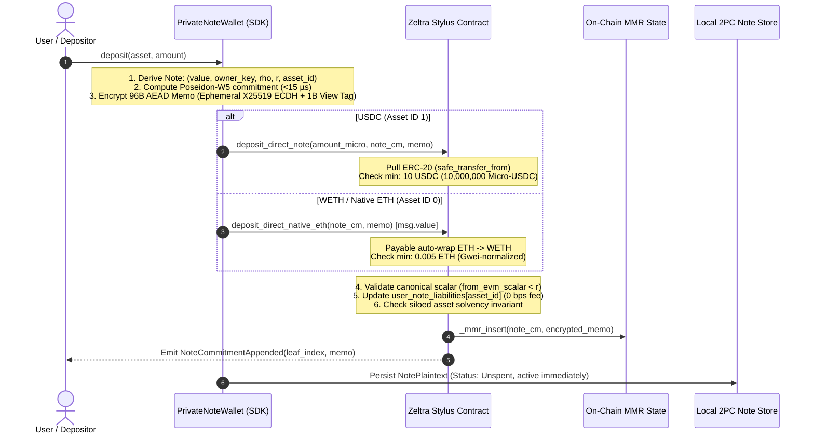
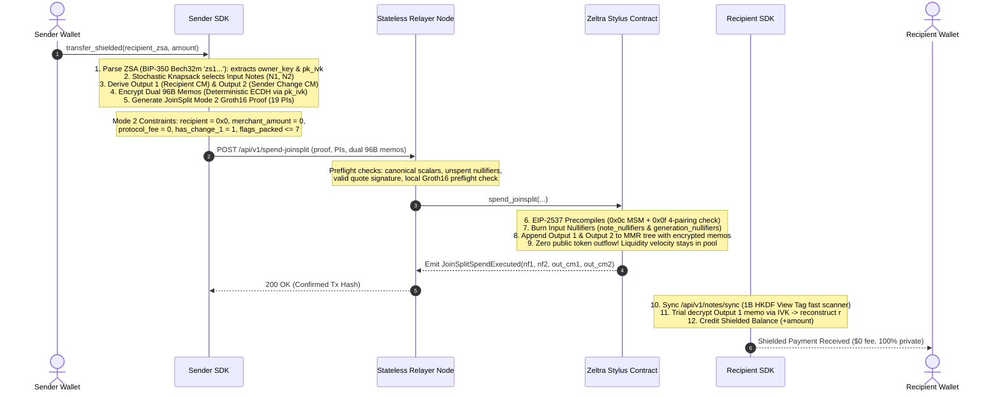
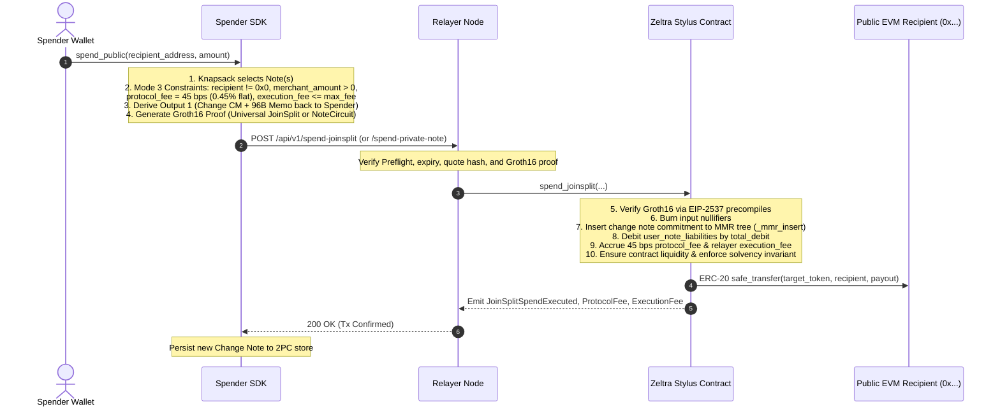
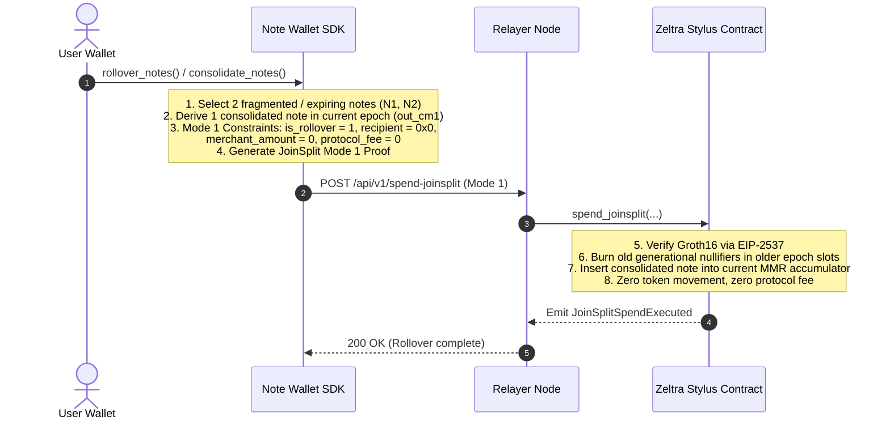
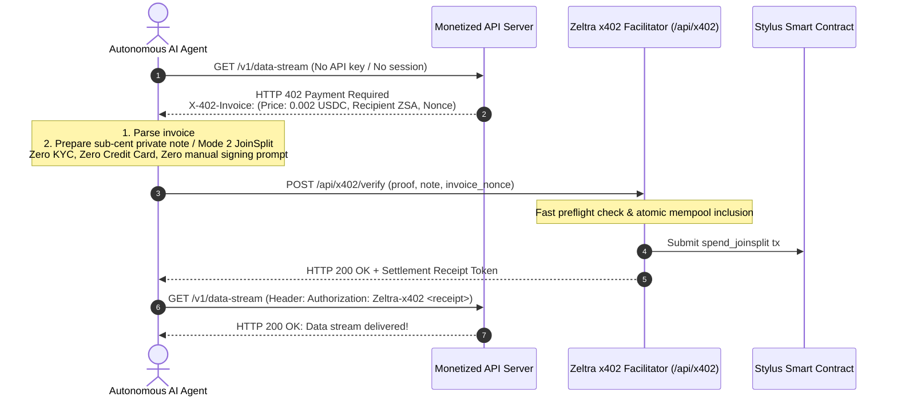
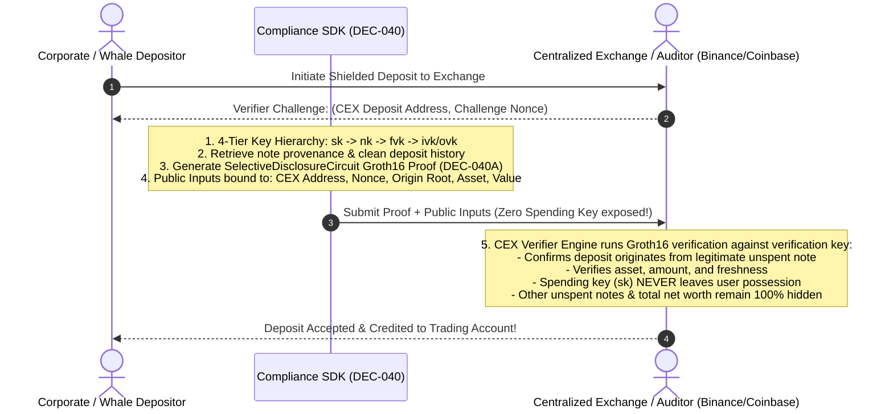

# AGENTS.md — Zeltra Protocol Master Agent Guide

## What This Is

**Zeltra Protocol** (codebase transition name: Zeltra) = **"The Stripe of Web3 with Absolute Privacy."** A high-throughput, shielded payment and settlement rail on Arbitrum Stylus for AI Agents, retail, whales, B2B corporates, and global merchants.

Full vision manifesto: [`VISION.md`](file:///workspaces/Zeltra-Protocol/VISION.md).

Product Mantra: **Privacy 9.5/10, Product 10/10.** Apple Pay / QRIS speed with real-cash mental accounting ($10 - $3 = $7 change via ZK-UTXO Private Notes, or direct peer-to-peer in-pool transfer). Engineering hell stays in the background; user experience stays effortless.

Dual sovereign rails (USDC & WETH / Native ETH), zero-friction inflow (0% deposit fee), volume-over-TVL economic velocity (0% in-pool transfer fee), and absolute mathematical solvency: **one deposit pays out exactly once, no more, no less.**

---

## Repo Layout & Code Mapping

Struktur kode lengkap dan pemetaan file detail dipusatkan di [`ARCHITECTURE.md`](file:///workspaces/Zeltra-Protocol/ARCHITECTURE.md).

Ringkasan domain crate:
- **`zeltra-contracts/`**: Stylus WASM Smart Contract (Arbitrum Nitro / EIP-2537 BLS12-381 Precompiles, Direct MMR Deposit, Strict 3-Mode JoinSplit).
- **`zeltra-core/`**: Arkworks BLS12-381 ZK Circuits (`PrivateNoteCircuit`, `JoinSplitCircuit`, `SelectiveDisclosureCircuit`), Poseidon hash, Flat MMR, Jacobian Soundness Engine (`jacobian.rs`, `formal_tests.rs`).
- **`zeltra-node/`**: Stateless Single-Sequencer Relayer (Axum 0.8, SQLite/SQLCipher AES-256 WAL, EIP-712 Quote, Ingress Spend, MMR Indexer, x402 Gateway).
- **`zeltra-sdk/`**: Client SDK & Private Note Wallet (`note_wallet/` modular, Knapsack selection, WASM Web Worker Prover DEC-041, x402 codec DEC-042, B2B Compliance DEC-040).
- **`zeltra-cli/`**: Pure ZK CLI Utility tool (key generation, deposit note, proof verification, CEX audit export).
- **`scripts/`**: Automation & verification test suites (`start_relayer.sh`, `test_dec046_dec047_jacobian_soundness.py`, `test_real_case_dec043c_inpool_wallet.py`).

Stack: Rust (Stylus SDK 0.10.7, Alloy 2.0, Arkworks 0.6.0 `ark-bls12-381` & `ark-groth16`), Axum 0.8, SQLite with SQLCipher AES-256 (`bundled-sqlcipher`), OpenBao/Vault KMS.

---

## Core Business Flows (Pure ZK-UTXO Architecture — DEC-038)

### 1. Inflow: Zero-Friction Direct MMR Deposit (USDC & WETH / Native ETH - DEC-038B / DEC-034B)

Single-step, atomic token issuance directly into the on-chain Merkle Mountain Range. Zero threshold ceremonies, zero blind signers, zero deposit fees (0 bps).



---

### 2. Shielded-to-Shielded In-Pool Transfer & Merchant Masking (Strict Mode 2 JoinSplit - DEC-043)

Circular liquidity velocity inside the pool. Zero public token transfers, zero protocol fees (0 bps), and complete transaction graph detachment.



---

### 3. Outflow: Public Spend & Change Note (Strict Mode 3 JoinSplit or 1-in-1-out)

Shielded-to-public off-ramp or direct merchant payment to an arbitrary EVM address.



---

### 4. Epoch Rollover & Note Consolidation (Strict Mode 1 JoinSplit - DEC-033 / DEC-043B)

Consolidate multiple fragmented notes or rollover notes nearing epoch expiry into the current active generation epoch.



---

### 5. Autonomous AI Agent Sub-Cent Micropayments (Pure ZK-UTXO HTTP 402 - DEC-042)

Machine-to-machine zero-latency private API monetization for autonomous AI agents.



---

### 6. Institutional Compliance & CEX Selective Disclosure (DEC-040)

Double-entry audit trail export and cryptographic origin verification for CEX deposits (Binance/Coinbase) and B2B corporate tax filings without compromising privacy.



---

## Invariants — Break These and It's a Critical Bug

**Accounting & Value Conservation (DEC-034B / DEC-038B):**
- **Siloed Multi-Asset Solvency:** `contract Token balance >= total_liabilities (user_note_liabilities[a] + accrued_execution_fee_liabilities[a] + realized_protocol_fees[a])` for each asset (USDC & WETH) — checked after every state change, reverts on insolvency.
- `gross_deposit = deposit_amount = net_liability` (deposit fee = 0 bps immutable).
- `Input Note(s) = Payout + Protocol Fee + Execution Fee + Change Note(s)` (ZK-UTXO value conservation).
- One commitment adds liability exactly once (inserted into MMR accumulator).
- One nullifier reduces liability exactly once (siloed `note_nullifiers[nullifier] == true` double-spend protection).

**Strict 3-Mode JoinSplit Rules (DEC-043B):**
- **Mode 1 (Mint / Consolidation / Rollover):** `recipient == Address::ZERO`, `merchant_amount == 0`, `protocol_fee == 0`.
- **Mode 2 (In-Pool Transfer):** `recipient == Address::ZERO`, `merchant_amount == 0`, `protocol_fee == 0`, `has_change_1 == true`. Dual 96-byte memos mandatory.
- **Mode 3 (Public Spend):** `recipient != Address::ZERO`, `protocol_fee == 45 bps`. Calldata memo 1 & memo 2 must be exactly 96 bytes each.

**Direct Deposit (DEC-038B / DEC-034B):**
- Inserts note commitment directly into Merkle Mountain Range (`_mmr_insert`).
- Commitment must be canonical scalar (`from_evm_scalar < r`), min amount (10 USDC or 0.005 WETH), non-zero.
- Emits `NoteCommitmentAppended` with 96-byte AEAD encrypted memo (zero storage bloat, log-only).
- Pure ZK-UTXO: no sessions, no threshold blind signers, no refund timelocks needed.

**Spend (ZK-UTXO Private Note & Universal JoinSplit):**
- ZK-UTXO Groth16 check via EIP-2537 (`0x0c` MSM + `0x0f` 4-pairing):
  `e(-A, B) * e(alpha, beta) * e(L, gamma) * e(C, delta) == 1`.
- Semantic public input binding (DEC-022 / DEC-035B / DEC-036A): exact match of root, nullifiers, output commitments, recipient, amounts, fees, two-limb quote hash, chain_id, contract_address, expiry, flags_packed, and is_rollover.
- Double-spend protection: generational nullifier & siloed note nullifiers (`note_nullifiers[nullifier] == true`).

**Circuit Security Invariants (DEC-046 & DEC-047 — Non-Negotiable on ANY Feature/Circuit Change):**
- **Zero Degrees of Freedom (DEC-046):** Every conditional branch, dummy slot, or selector wire MUST be deterministically bound via quadratic companion constraints (`cond * (val - canonical) == 0`). Inactive branches cannot have floating, unconstrained, or malleable degrees of freedom.
- **Tangent Rigidity & Jacobian Soundness (DEC-047):** Every circuit modification or new feature MUST pass the Augmented Jacobian rank verification $M(a) = \begin{pmatrix} J(a) \\ E_F \end{pmatrix}$ with financial target nullity $r_{T_{\text{financial}}} = 0$ across the full 6-family adversarial witness matrix (*Witness-Locality Sweep*, IACR 2026/1852 in `formal_tests.rs`). Single-witness testing is strictly forbidden.

**CCIP:**
- Router must be non-zero, source chain + sender allowlisted, message ID replay-protected.
- Source confirmation ≠ destination confirmation.

---

## Behavior Rules for AI Agents

### Before Coding

1. **Check Real Source Code First (No Guessing):**
   - Never assume API signatures or types from memory or summaries alone. Open and inspect actual Rust definitions before editing or documenting.
2. **Read `todo.md`:**
   - Check item status before touching it. Do not duplicate backlog management across arbitrary files.
3. **Avoid Bureaucratic Bloat (Zero Fluff Documentation):**
   - Keep architectural findings inside [`research/dec/`](file:///workspaces/Zeltra-Protocol/research/dec/) and chapter guides in [`docs/`](file:///workspaces/Zeltra-Protocol/docs/). Never spawn random markdown checklists or fragmented files that distract developers.
4. **Graphify-First Navigation (Mandatory Reflex):**
   - *Graph Topology:* Before grep or reading raw files, run `graphify query "<question>"` (or MCP `query_graph`), `graphify explain "<Symbol>"` (or MCP `get_node`), or `graphify path "<A>" "<B>"` (or MCP `shortest_path`).
   - *Prohibition:* Never dump raw `graphify-out/graph.json` or monolithic `GRAPH_REPORT.md` into the LLM context.
   - *Code Exploration:* Use CodeGraph (`codegraph_explore` or shell `codegraph explore "<query>"`) for line-numbered verbatim source and dynamic-dispatch call paths.
   - *Keep Graph Fresh:* After modifying Rust source files, run `graphify update .` (AST-only, zero API cost).
5. **ATMI Principle (Amati, Tiru, Modifikasi, Inovasi):**
   - Absorb proven patterns from battle-tested crypto repos and papers (Zcash, Aztec Barretenberg, Railgun, zk-kit, zk-sunade, Wasabi). Modify for Stylus / BLS12-381 / ZK-UTXO, and innovate new UX/privacy edges.
6. **Research Gate & External Intel (Exa & Tavily):**
   - *Exa MCP (`web_search_exa`, `web_fetch_exa`):* Semantic & Deep Technical Search. Best for cryptography papers (2024–2026), audit post-mortems, deep architecture, and external crate implementations.
   - *Tavily MCP (`tavily_search`, `tavily_extract`, `tavily_crawl`):* Real-Time Fact, News & Ecosystem Intel. Best for live Arbitrum/Stylus releases, governance proposals (AIP), and immediate fact checks.
   - *Synergy:* Map ecosystem landscape with Tavily, dive deep into technical papers with Exa, and document key findings in `research/dec/`.
7. **Groq LPU Acceleration (`qwen/qwen3.8-27b`):**
   - Ultra-fast inference engine (~200–400+ tok/s) via OpenAI-compatible endpoint (`OPENAI_BASE_URL="https://api.groq.com/openai/v1"`). Used for zero-delay Graphify semantic extraction and fast benchmarking.

### While Coding

1. **Circuit Status (FLEXIBLE & UNLOCKED):**
   - Deploy Arbitrum is on pause/freeze (October 2026). Circuits are **NOT FROZEN (UNLOCKED & FLEXIBLE)**. Full flexibility exists to refine gadgets, optimize constraints, and update public inputs without premature freeze anxiety.
2. **Circuit Security Dual Gate (DEC-046 & DEC-047 — MANDATORY ON ANY NEW FEATURE OR R1CS EDIT):**
   - **Design Gate (DEC-046 — Deterministic Companion Constraints):**
     * Whenever adding new features, conditional logic, dummy inputs/outputs, or selector flags in `zeltra-core`, you MUST bind inactive wires using quadratic companion constraints (`cond * (val - dummy_canonical) == 0` or inverse zero-safe gadgets).
     * Inactive wire degrees of freedom MUST collapse to canonical constants (**Zero Degrees of Freedom**). Floating or underconstrained wires in inactive branches are critical vulnerabilities.
   - **Verification Gate (DEC-047 — Augmented Jacobian Soundness):**
     * Any new feature or constraint modification MUST pass the Augmented Jacobian verification $M(a) = \begin{pmatrix} J(a) \\ E_F \end{pmatrix}$ in [`formal_tests.rs`](file:///workspaces/Zeltra-Protocol/zeltra-core/src/formal_tests.rs).
     * Verify tangent rigidity $e_j^T \in \text{rowspan}(M(a))$ with financial target nullity $r_{T_{\text{financial}}} = 0$.
     * Single-witness testing is strictly forbidden. Must pass the **6-Family Adversarial Witness-Locality Sweep** (IACR 2026/1852):
       1. Standard Valid Witness
       2. Single Active Branch with Zeroed Dummy
       3. Both Inactive Branch (Null Execution)
       4. Zero Input Value Boundary
       5. Max Scalar Field Overflow Boundary ($p - 1$)
       6. Adversarial Non-Canonical Flag Manipulation
3. **Zero Breaking Changes for Public APIs:**
   - Preserve exported signatures in `lib.rs` for cross-crate compatibility across `zeltra-core`, `zeltra-contracts`, `zeltra-node`, `zeltra-sdk`, and `zeltra-cli`.
4. **Code Quality & Rust Standards:**
   - `cargo fmt` + `clippy` clean across workspace.
   - Never bypass crypto verification with `#[cfg(test)]` in production code paths.
   - Never fall back to mock/test keys when secrets are unavailable — fail closed.
   - Never hardcode addresses, keys, or credentials.
   - Never mutate contract storage layout without considering upgrade paths.
   - Don't add features outside the assigned task scope.

### While Testing

1. **Circuit Soundness Verification (DEC-046 & DEC-047):**
   - Run `python3 scripts/test_dec046_dec047_jacobian_soundness.py` and `cargo test -p zeltra-core formal_tests` to verify zero degree-of-freedom and Jacobian tangent rigidity before touching production circuits.
2. Positive test + at least 2x more negative tests.
3. Negative tests must prove state is completely unchanged on failure.
4. Critical features need testnet verification (Arbitrum Sepolia) — unit tests alone are insufficient.
5. Always wait for on-chain receipt and check status — broadcast alone is not proof of success.
6. Tests fail if using: mock transaction hash, dummy signature, or random bytes as ZK proof.

### Secrets & Security

- Never log or commit: private keys, Vault tokens, guardian shares, DB encryption keys, or sensitive note preimages.

---

## Fee Structure

| Operation / Flow | Rate | Where | Rationale |
|---|---|---|---|
| Inflow (Deposit) | 0 bps (0.00%) | `deposit.rs` + `fees.rs` | Zero-friction liquidity entry (DEC-038B / DEC-034B) |
| In-Pool Transfer (Mode 2) | 0 bps (0.00%) | `spend.rs` + `fees.rs` | Circular liquidity velocity inside pool (DEC-043B) |
| Public Outflow Spend (Mode 3) | 45 bps (0.45% Flat) | `spend.rs` + `fees.rs` | Protocol monetization upon withdrawal (DEC-028) |
| Relayer Execution | Gas reimbursement + 15% markup | `quote.rs` + `fees.rs` | Zero-oracle gas reimbursement in native units (DEC-031 / DEC-034C) |

---

## Environment & Deployment

- **Runtime Config:** `zeltra-node/.env.test` is the single source of truth (RPC URLs, keys, contract addresses, DB cipher keys, Vault/KMS settings). Always run `source zeltra-node/.env.test` before executing nodes or deployment tools.
- **Stylus Contract Deployment:** `cargo stylus check` / `cargo stylus deploy` from `zeltra-contracts/`.
- **Relayer Sequencer Daemon (DEC-038A):**
  ```bash
  bash scripts/start_relayer.sh {start|status|stop|restart}
  ```
  Auto-loads `zeltra-node/.env.test` for RPC/contract/key. Health checks: `/health` & `/live`.

---

## Key Files & References

- [`todo.md`](file:///workspaces/Zeltra-Protocol/todo.md) — Master active backlog & test status
- [`VISION.md`](file:///workspaces/Zeltra-Protocol/VISION.md) & [`docs/bisnis.md`](file:///workspaces/Zeltra-Protocol/docs/bisnis.md) — Product vision, business model, & fee architecture
- [`docs/`](file:///workspaces/Zeltra-Protocol/docs/) — Documentation (`bisnis.md`, `roadmap.md`, `X402_INTEGRATION_STRATEGY.md`, `analisis/`)
- [`research/dec/`](file:///workspaces/Zeltra-Protocol/research/dec/) — 72 Architecture Decision Records (DEC-001 through DEC-048)
