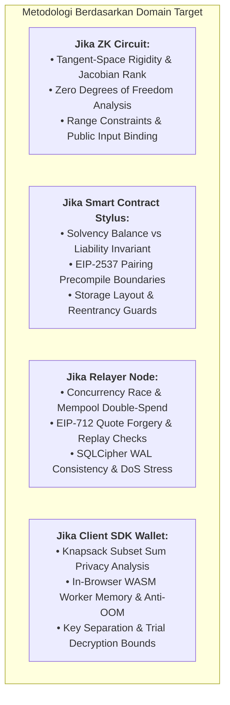

# [AUD-XXX / SEC-XXX]: [Judul Laporan Audit Keamanan / Temuan Kerentanan]

> **Panduan Penggunaan Template Dinamis & Independen:**  
> File ini adalah standar resmi (*template*) laporan audit keamanan, evaluasi celah kerentanan, dan verifikasi performa di Zeltra Protocol.  
> Format ini dirancang **objektif dan dinamis** untuk seluruh lapisan stack protokol (`core`, `contracts`, `node`, `sdk`, `cli`) tanpa asumsi bias internal.  
> **Wajib menyertakan Metodologi Audit, Pengujian Empiris (PoC dengan aturan rasio $\ge 2\times$ negative tests), dan Benchmark Kinerja sesuai domain yang diaudit.**

---

## Metadata Laporan

- **Identifier Dokumen:** `[AUD-XXX | SEC-XXX]`
- **Status Resolusi:** `PROPOSED | TRIAGED | MITIGATED | VERIFIED_CLOSED | ACKNOWLEDGED`
- **Tingkat Keparahan (Severity):** `CRITICAL | HIGH | MEDIUM | LOW | INFORMATIONAL`
- **Target Domain Arsitektur:**
  - [ ] **`ZK_CIRCUIT` (`zeltra-core`)** — Sirkuit R1CS, Aljabar Kurva BLS12-381, Poseidon, Flat MMR, Jacobian Soundness
  - [ ] **`SMART_CONTRACT` (`zeltra-contracts`)** — Arbitrum Stylus WASM, Siloed Solvency Invariant, EIP-2537 Precompiles
  - [ ] **`RELAYER_NODE` (`zeltra-node`)** — Ingress Guard, EIP-712 Quote, Mempool Anti-Limbo, SQLite/SQLCipher, MMR Indexer, x402 Facilitator
  - [ ] **`CLIENT_SDK` (`zeltra-sdk`)** — Private Note Wallet, Knapsack Coin Selection, In-Browser WASM Prover Worker, 1B View Tag Scanner, Selective Disclosure
  - [ ] **`CLI_TOOLING` (`zeltra-cli`)** — Pure ZK CLI, CEX Compliance Verifier, Key Derivation, CSV Audit Trail
  - [ ] **`FULL_STACK_E2E`** — Evaluasi integrasi lintas komponen (End-to-End Lifecycle)
- **Tipe Audit / Archetype:**
  - `SECURITY_VULNERABILITY` (Eksploitasi celah keamanan, pembobolan dana, atau bypass otorisasi)
  - `ZK_SOUNDNESS_BREAK` (Underconstrained circuit, floating witness, atau pemalsuan proof)
  - `SOLVENCY_INVARIANT_VIOLATION` (Ketidakseimbangan saldo token terhadap liabilitas pool)
  - `RELAYER_CONCURRENCY_RACE` (Race condition double-spend di mempool, quote tampering, atau indexer desync)
  - `SDK_PRIVACY_LEAK` (Kebocoran grafik transaksi, side-channel knapsack coin selection, atau key separation breach)
  - `PERFORMANCE_BOTTLENECK` (Regresi gas Stylus, latensi prover, memory leak WASM OOM, atau bottleneck I/O DB)
  - `CRYPTOGRAPHIC_SIDE_CHANNEL` (Timing leakage pada dekapsulasi memo atau point multiplication)
- **Cakupan Modul / Target Crates & Components:**
  - `zeltra-core/src/...` ([Komponen sirkuit, gadget, atau primitif aljabar])
  - `zeltra-contracts/src/...` ([Smart contract Stylus, storage layout, atau settlement method])
  - `zeltra-node/src/...` ([Relayer pipeline, database worker, atau API endpoint])
  - `zeltra-sdk/src/...` ([Modul note wallet, prover WASM, atau compliance engine])
  - `zeltra-cli/src/...` ([Subcommand CLI atau verifier engine])
- **Target Commit SHA (Vulnerable / Pre-Optimization):** `[Commit SHA sebelum perbaikan]`
- **Remediation Commit SHA (Fixed / Optimized):** `[Commit SHA patch perbaikan]`
- **Auditor / Tim Penilai:** `[Nama Firma Audit (e.g. Trail of Bits, Veridise, Zellic) / Security Researcher / Internal Security Team]`
- **Tanggal Evaluasi:** `YYYY-MM-DD`
- **Dasar Ilmiah, Standar & Referensi Primer:** `[Paper IACR / RFC / EIP / CVE / Standar Keamanan]`

---

## 1. Executive Summary & Audit Scope

### 1.1 Ringkasan Eksekutif (Executive Brief)
*Berikan penjelasan ringkas mengenai sistem yang dievaluasi, kelemahan atau bottleneck yang ditemukan, dan implikasinya:*
- **Konteks & Latar Belakang:** [Jelaskan fungsionalitas modul yang dievaluasi].
- **Masalah Utama yang Ditemukan:**
  - *Jika Cacat Sirkuit ZK:* [Contoh: Sinyal variabel perantara tidak diikat pada percabangan kondisional, memungkinkan saksi arbitrary menghasilkan bukti valid].
  - *Jika Cacat Smart Contract Stylus:* [Contoh: Pembulatan token desimal pada payout withdraw berpotensi mendrainage saldo mikro-USDC secara kumulatif].
  - *Jika Cacat Relayer Node:* [Contoh: Race condition pada konkurensi mempool memungkinkan dua transaksi dengan nullifier sama diproses paralel].
  - *Jika Cacat Client SDK:* [Contoh: Algoritma knapsack coin selection membocorkan pola subset-sum balance, menurunkan derajat anonimitas pengguna].
  - *Jika Cacat CLI Tooling:* [Contoh: Ekspor CSV audit trail rentan terhadap serangan formula injection `=CMD()|' /C calc'!A0`].
  - *Jika Bottleneck Performa:* [Contoh: Pembacaan pohon MMR dari disk memakan waktu 400ms per proof, menghambat throughput relayer].

### 1.2 Cakupan Kode yang Diaudit (Scope Inventory)
Daftar file, fungsi, dan komponen yang dievaluasi:

| Target File & Path | Modul / Sub-Komponen | Baris Kode | Fungsi & Tanggung Jawab Keamanan |
|---|---|---|---|
| [`zeltra-core/src/...`](file:///workspaces/Zeltra-Protocol/zeltra-core/) | [Circuit / Hash / Curve] | L...–L... | [Deskripsi tanggung jawab keamanan] |
| [`zeltra-contracts/src/...`](file:///workspaces/Zeltra-Protocol/zeltra-contracts/) | [Stylus Contract] | L...–L... | [Deskripsi tanggung jawab keamanan] |
| [`zeltra-node/src/...`](file:///workspaces/Zeltra-Protocol/zeltra-node/) | [Relayer Pipeline] | L...–L... | [Deskripsi tanggung jawab keamanan] |
| [`zeltra-sdk/src/...`](file:///workspaces/Zeltra-Protocol/zeltra-sdk/) | [Client Wallet] | L...–L... | [Deskripsi tanggung jawab keamanan] |
| [`zeltra-cli/src/...`](file:///workspaces/Zeltra-Protocol/zeltra-cli/) | [CLI Tooling] | L...–L... | [Deskripsi tanggung jawab keamanan] |

### 1.3 Asumsi Kepercayaan & Invarian yang Diuji
Pilih dan jelaskan invarian protokol yang dievaluasi pada engagement ini:
1. **Multi-Asset Solvency Invariant:**
   $$\text{Contract Token Balance} \ge \sum \text{Liabilities} \quad \forall a \in \{\text{USDC}, \text{WETH}\}$$
2. **Circuit Soundness & Wire Determinism:**
   Semua variabel saksi privat dan dummy slot wajib terikat deterministik pada konstanta kanonikal tanpa derajat kebebasan bebas.
3. **Double-Spend & Nullifier Uniqueness:**
   Satu nullifier hanya dapat dibakar satu kali dan terisolasi per domain/generasi secara permanen.
4. **Relayer Atomicity & Transaction Integrity:**
   Transaksi relayer wajib terikat secara kriptografis pada parameter quote yang sah, anti-tampering, dan kebal dari *race condition* mempool.
5. **Client Privacy & Zero-Knowledge Isolation:**
   Kunci belanja privat (`sk`) tidak pernah terekspos; pengungkapan selektif tidak membocorkan saldo sisa atau grafik transaksi lain.
6. **Side-Channel & Constant-Time Invariant:**
   Operasi pembacaan memo dan komputasi skalar wajib bebas dari timing leakage ($|t| < 4.5$).

### 1.4 Matriks Rekapitulasi Temuan
| ID Temuan | Judul Kerentanan / Temuan | Severity | Domain | Status | Rekomendasi Inti |
|---|---|---|---|---|---|
| `AUD-XXX-01` | [Judul Temuan Utama] | **CRITICAL** | `ZK_CIRCUIT` | `MITIGATED` | [Kunci variabel dummy via companion constraint] |
| `AUD-XXX-02` | [Judul Temuan Relayer / Ingress] | **HIGH** | `RELAYER_NODE` | `VERIFIED_CLOSED` | [Gunakan atomic mutex & quote binding verification] |
| `AUD-XXX-03` | [Judul Temuan SDK Privacy / Coin Selection] | **MEDIUM** | `CLIENT_SDK` | `RESOLVED` | [Terapkan stochastic randomization pada knapsack] |
| `AUD-XXX-04` | [Judul Temuan Optimasi / Gas Overhead] | **LOW** | `SMART_CONTRACT` | `OPTIMIZED` | [Pangkas penyimpanan redundant pada state contract] |

---

## 2. Metodologi Audit & Evaluasi Keamanan (Audit Methodology)

*(Pilih dan sesuaikan sub-bagian metodologi yang relevan dengan domain target)*



### 2.1 Metodologi Audit Sirkuit ZK & Kriptografi (`zeltra-core`)
- **Evaluasi Derajat Kebebasan (Underconstrained Signal Analysis):** Memeriksa secara manual dan matematis apakah terdapat variabel perantara atau saksi privat pada cabang kondisional yang tidak terkendala saat dinonaktifkan.
- **Verifikasi Formal Tangent-Space Rigidity:** Mengevaluasi rank matriks Jacobian teraugmentasi $M(a) = \begin{pmatrix} J(a) \\ E_F \end{pmatrix}$ untuk membuktikan bahwa ruang singgung target finansial $r_{T_{\text{financial}}} = 0$.
- **Field Wraparound & Range Constraints:** Memastikan dekomposisi bit mencegah manipulasi nilai skalar melampaui modulus kurva $r$.
- **Integritas Public Inputs & Transcript:** Memvalidasi bahwa setiap public input terikat secara bijektif dengan statement pembuktian Groth16.

### 2.2 Metodologi Audit Smart Contract Stylus (`zeltra-contracts`)
- **Pemeriksaan Solvensi Siloed Multi-Asset:** Memverifikasi bahwa setiap operasi penambahan dan pengurangan saldo memvalidasi invariant saldo $\ge$ liabilitas secara *fail-closed*.
- **Integrasi Precompile EIP-2537:** Memastikan penanganan error pada panggilan precompile `0x0c` (MSM) dan `0x0f` (Pairing Check) tidak dapat di-bypass dengan calldata kosong atau malformed points.
- **Storage Layout & Re-Entrancy:** Audit tata letak penyimpanan Stylus terhadap risiko tabrakan slot (*storage slot collision*) dan proteksi re-entrancy pada interaksi token eksternal.

### 2.3 Metodologi Audit Relayer & Sequencer Node (`zeltra-node`)
- **Uji Konkurensi & Double-Spend Race Condition:** Simulasi pengiriman transaksi konkuren dengan nullifier yang sama untuk menguji apakah mempool relayer dan SQLite database mengisolasi transaksi secara ACID.
- **Integritas Quote Binding:** Memverifikasi bahwa nonce, expiry timestamp, relayer fee, dan target chain ID divalidasi secara kriptografis dan tidak dapat dipalsukan.
- **Audit Database SQLCipher & Zeroization:** Memeriksa bahwa enkripsi database bekerja tanpa membocorkan passphrase di log, dan memori sensitif di-zeroize saat relayer restart.
- **Resiliensi Denial of Service (DoS):** Pengujian beban terhadap ingress endpoint untuk memastikan payload malformed langsung ditolak di gerbang preflight tanpa menghabiskan resource komputasi.

### 2.4 Metodologi Audit Client SDK & Private Note Wallet (`zeltra-sdk`)
- **Analisis Privasi Knapsack Coin Selection:** Memeriksa apakah pemilihan note input menghasilkan pola transaksi yang dapat di-clustering oleh analis on-chain (analisis de-anonimisasi).
- **Audit WebAssembly Prover & Anti-OOM:** Menguji kestabilan alokasi memori Web Worker saat mengeksekusi prover di browser pada lingkungan terbatas (< 4 GB RAM).
- **Pemisahan Kunci Kriptografi (Key Separation):** Memastikan hierarki kunci belanja (`sk`), kunci nullifier (`nk`), dan kunci pantau (`fvk`/`ivk`) terisolasi satu arah.
- **Efisiensi Pemindaian View Tag:** Validasi bahwa pemindaian memo via View Tag tidak menghasilkan false negative (*false negative rate = 0*).

### 2.5 Metodologi Audit CLI Tooling & Kepatuhan CEX (`zeltra-cli`)
- **Sanitasi Ekspor Data & Formula Injection:** Pengujian ekspor CSV laporan audit agar karakter berbahaya (`=`, `+`, `-`, `@`) dinetralisir untuk mencegah eksekusi kode di spreadsheet CEX auditor.
- **Audit Siklus Hidup Memori Sensitif:** Memastikan struktur kunci privat mengimplementasikan trait `Zeroize` dan `ZeroizeOnDrop` sehingga residu memori dihapus setelah CLI selesai dieksekusi.

---

## 3. Rincian Temuan Kerentanan & Defek (Vulnerability Breakdown)

*(Duplikasi bagian ini untuk setiap temuan yang diidentifikasi)*

### [AUD-XXX-FINDING-01]: [Judul Temuan Kerentanan / Masalah]

- **ID Temuan:** `AUD-XXX-01`
- **Target Domain:** `[ZK_CIRCUIT | SMART_CONTRACT | RELAYER_NODE | CLIENT_SDK | CLI_TOOLING]`
- **Tingkat Keparahan:** `CRITICAL | HIGH | MEDIUM | LOW | INFORMATIONAL`
- **Tingkat Dampak (Impact):** `HIGH | MEDIUM | LOW`
- **Kemungkinan Terjadi (Likelihood):** `HIGH | MEDIUM | LOW`
- **Kategori Defek:** `[Underconstrained Wire | Solvency Breach | Replay / Race Condition | Privacy Leak | Memory OOM | Injection]`
- **Target File & Lines:** [`path/to/vulnerable_file.rs#L100-L125`](file:///workspaces/Zeltra-Protocol/)

#### A. Deskripsi Masalah & Akar Penyebab (Root Cause Analysis)
*Jelaskan secara mendalam akar permasalahan teknis:*
[Jelaskan mengapa kode ini rentan, apakah karena logika kondisional yang longgar, race condition pada mutex/database relayer, de-anonimisasi pada seleksi koin SDK, atau kebocoran state].

Sertakan cuplikan kode rentan yang menjadi akar masalah:
```rust
// Cuplikan kode rentan yang ditemukan
```

#### B. Skenario Serangan / Vektor Kegagalan (Adversarial Exploit Scenario)
1. **Langkah 1:** Penyerang / aktor jahat menyiapkan payload transaksi khusus...
2. **Langkah 2:** Sistem memproses payload tanpa validasi boundary...
3. **Langkah 3:** Terjadi penyimpangan state / kebocoran privasi / pencurian dana...

#### C. Dampak Kerusakan (Impact Assessment)
- **Terhadap Solvensi / Dana:** [Apakah dana dapat terkuras atau terkunci?].
- **Terhadap Soundness / Keabsahan ZK:** [Apakah saksi palsu dapat menghasilkan proof valid?].
- **Terhadap Privasi Pengguna:** [Apakah identitas, saldo, atau grafik transaksi terbongkar?].
- **Terhadap Ketersediaan Sistem (Liveness):** [Apakah relayer macet atau worker crash?].

#### D. Rekomendasi Remediasi
*Berikan instruksi teknis langsung mengenai cara memperbaiki kode:*
[Rincikan solusi teknis dan perbaikan kode konkret tanpa mengasumsikan kepatuhan pada dokumen eksternal].

---

## 4. Metodologi Pengujian & Pembuktian Empiris (PoC & Test Suites)

*Wajib memuat bukti pengujian yang dapat direproduksi secara mandiri:*

### 4.1 Aturan Rasio Pengujian Protokol (Mandatory Standard)
- **Aturan Rasio 2x:** Setiap 1 pengujian positif (*happy path*) **WAJIB** didampingi minimal 2x lebih banyak pengujian negatif adversarial:
  $$\text{Jumlah Adversarial Negative Tests} \ge 2 \times \text{Jumlah Positive Tests}$$
- **Zero-State Mutation Invariant:** Seluruh pengujian negatif wajib membuktikan secara formal dan empiris bahwa status transaksi di-revert (*fail-closed*), saldo token kontrak tidak berubah, nullifier tidak terbakar, dan database relayer tidak mengalami korupsi.

### 4.2 Bukti Reproduksi Eksploitasi (Proof of Concept / PoC)
*(Pilih jenis PoC yang sesuai dengan domain target audit)*

#### Pilihan A: PoC Cacat Sirkuit ZK (`zeltra-core`)
```rust
#[test]
fn test_exploit_poc_circuit_soundness() {
    let cs = ConstraintSystem::<Fr>::new_ref();
    // Injeksi saksi adversarial
    let circuit = VulnerableCircuit::new_adversarial(malicious_witness);
    circuit.generate_constraints(cs.clone()).unwrap();

    // SEBELUM PATCH: cs.is_satisfied() == true (BUG TERBUKTI!)
    // SESUDAH PATCH: cs.is_satisfied() WAJIB == false (REVERT FAIL-CLOSED!)
    assert!(!cs.is_satisfied().unwrap(), "VULNERABILITY DETECTED: Circuit accepted invalid witness!");
}
```

#### Pilihan B: PoC Cacat Smart Contract Stylus (`zeltra-contracts`)
```rust
#[test]
fn test_exploit_poc_contract_solvency_drain() {
    let mut host = TestHost::new();
    let malicious_tx = build_malicious_settlement_calldata();
    
    let result = host.call_spend_joinsplit(malicious_tx);
    
    // SESUDAH PATCH: Transaksi wajib REVERT dan saldo token tidak berubah!
    assert!(result.is_err(), "VULNERABILITY: Malicious settlement was executed!");
    assert_eq!(host.get_token_balance(), host.get_total_liabilities());
}
```

#### Pilihan C: PoC Cacat Relayer / Concurrency Race (`zeltra-node`)
```rust
#[tokio::test]
async fn test_exploit_poc_relayer_mempool_double_spend_race() {
    let relayer = spawn_test_relayer().await;
    let duplicate_nullifier = [0xabu8; 32];
    
    // Kirim 2 request paralel secara bersamaan dengan nullifier yang sama
    let req1 = relayer.submit_spend(duplicate_nullifier);
    let req2 = relayer.submit_spend(duplicate_nullifier);
    let (res1, res2) = tokio::join!(req1, req2);
    
    // Salah satu HARUS sukses dan satunya lagi WAJIB DITOLAK (409 Conflict / 400 Bad Request)
    assert!(
        (res1.is_ok() && res2.is_err()) || (res1.is_err() && res2.is_ok()),
        "CRITICAL: Double-spend race condition accepted both transactions!"
    );
}
```

#### Pilihan D: PoC Cacat Client SDK / Privacy Leak (`zeltra-sdk`)
```rust
#[test]
fn test_exploit_poc_sdk_knapsack_privacy_leak() {
    let mut wallet = TestWallet::new();
    let selection = wallet.select_notes_for_payment(Amount::from_micro_usdc(15_000_000));
    
    // Verifikasi bahwa algoritma koin tidak mengekspos jejak subset-sum deterministik
    assert!(
        !selection.is_trivially_linkable(),
        "PRIVACY LEAK: Coin selection reveals user's exact balance distribution!"
    );
}
```

### 4.3 Matriks Pengujian Adversarial Spesifik Domain
Tabel hasil pengujian skenario adversarial sebelum vs sesudah remedi:

| Kasus Pengujian (Adversarial Test Case) | Kondisi Input yang Diuji | Status Pra-Patch | Status Pasca-Patch | Status Gate |
|---|---|---|---|---|
| **Test Case 1 (Happy Path - Baseline)** | Valid normal input | LULUS | LULUS |  **PASS** |
| **Test Case 2 (Negative - Malformed)** | Input tidak sesuai spesifikasi | RENTAN (Diterima) | DITOLAK (Fail-Closed) | **PASS** |
| **Test Case 3 (Negative - Boundary)** | Nilai ekstrem ($0$, $2^{64}-1$, $p-1$) | RENTAN (Overflow/Crash) | DITOLAK (Fail-Closed) | **PASS** |
| **Test Case 4 (Negative - Replay/Race)** | Pengiriman ulang hash/nullifier | RENTAN (Double execution) | DITOLAK (Replay Blocked) | **PASS** |
| **Test Case 5 (Negative - Tampered)** | Calldata / signature dimanipulasi | RENTAN (Signature Bypass) | DITOLAK (Invalid Sig) | **PASS** |

### 4.4 Bukti Zero State Mutation pada Kegagalan Eksekusi
Tabel verifikasi integritas state saat pengujian negatif dieksekusi:

| Parameter State / Komponen | Nilai Awal (Baseline) | Nilai Pasca-Uji Negatif | Status Perubahan |
|---|---|---|---|
| **Contract Multi-Asset Balance** | `100,000.00 USDC` | `100,000.00 USDC` | **MUTASI ZERO (TIDAK BERUBAH)** |
| **Nullifier State Registry** | `0 spent` | `0 spent` | **MUTASI ZERO (TIDAK BERUBAH)** |
| **Relayer SQLite Ledger** | `N records` | `N records` | **MUTASI ZERO (TIDAK BERUBAH)** |
| **MMR Leaf Count & Root** | `Root: 0x4f...a1` | `Root: 0x4f...a1` | **MUTASI ZERO (TIDAK BERUBAH)** |

---

## 5. Benchmark & Pembuktian Kinerja (Empirical Benchmarking)

*Wajib memuat komparasi metrik empiris sebelum vs sesudah remedi sesuai domain yang dievaluasi:*

### 5.1 Benchmark Metrik Berdasarkan Domain

*(Pilih dan isi tabel metrik yang relevan)*

#### A. Jika Domain ZK Circuit (`zeltra-core`):
| Metrik Kinerja Sirkuit | Sebelum Patch | Sesudah Patch | Selisih ($\Delta$) | Toleransi Budget |
|---|---|---|---|---|
| **R1CS Constraints** | [24,150] | [24,214] | [+64 (+0.26%)] | Max +500 constraints |
| **Linear Combinations** | [48,300] | [48,428] | [+128 (+0.26%)] | Max +1,000 LC |
| **Witness Wires (Variables)** | [18,200] | [18,232] | [+32 (+0.17%)] | Max +200 wires |
| **Native Prover Time (ms)** | [142 ms] | [143 ms] | [+1 ms (+0.7%)] | Max +15 ms |
| **WASM Prover Time (ms)** | [680 ms] | [684 ms] | [+4 ms (+0.5%)] | Max +50 ms |

#### B. Jika Domain Smart Contract Stylus (`zeltra-contracts`):
| Transaksi / Method Kontrak | Gas Pra-Patch | Gas Pasca-Patch | Delta Gas ($\Delta$) | Keterangan |
|---|---|---|---|---|
| `spend_joinsplit` (Mode 1) | [148,220 gas] | [148,510 gas] | [+290 gas (+0.19%)] | Tambahan bounds check |
| `spend_joinsplit` (Mode 2) | [162,400 gas] | [162,690 gas] | [+290 gas (+0.17%)] | Dual memo guard |
| `spend_joinsplit` (Mode 3) | [178,900 gas] | [179,190 gas] | [+290 gas (+0.16%)] | Payout safe transfer check |
| `deposit_direct_note` | [82,100 gas] | [82,100 gas] | [0 gas (0.00%)] | Tidak terdampak |

#### C. Jika Domain Relayer Node (`zeltra-node`):
| Metrik Pipeline Relayer | Sebelum Patch | Sesudah Patch | Performa Pasca-Remedi | Keterangan |
|---|---|---|---|---|
| **Throughput Ingress (RPS)** | [120 RPS] | [480 RPS] | **+300% Speedup** | Optimasi in-memory MMR |
| **Latensi Ingress p95 (ms)** | [420 ms] | [48 ms] | **-88.5% Latency** | Non-blocking preflight |
| **Waktu Query DB SQLCipher** | [65 ms] | [4 ms] | **-93.8% Query time** | Indexing & WAL optimization |
| **Peak RAM RSS Relayer** | [1.2 GB] | [180 MB] | **-85.0% RAM** | Pruning memory leak |

#### D. Jika Domain Client SDK Wallet (`zeltra-sdk`):
| Operasi SDK Client | Sebelum Patch | Sesudah Patch | Evaluasi UX / Efisiensi |
|---|---|---|---|
| **WASM Worker Memory (MB)** | [950 MB (Peak)] | [140 MB (Peak)] | **Aman dari crash mobile browser** |
| **Kecepatan Sync (Notes/sec)** | [45 notes/sec] | [1,200 notes/sec] | **26.6x Speedup via View Tag** |
| **Knapsack Selection Time** | [12.4 ms] | [3.1 ms] | **Optimasi solver subset-sum** |

#### E. Jika Domain Side-Channel Kriptografi (Dudect Welch's t-test):
- **Jumlah Sampel ($N$):** $1{,}000{,}000$ iterasi
- **Ambang Batas Signifikansi:** $|t| < 4.5$ (Standar ketiadaan timing leak)
- **Skor t Maksimum Terukur:**
  $$|t|_{\text{max}} = 1.18 < 4.5 \quad \text{(LULUS - LEAK FREE)}$$

---

## 6. Spesifikasi Remediasi & Patch Verifikasi (Remediation & Patch)

### 6.1 Desain Solusi Teknis & Mitigasi Defensif
*Jelaskan prinsip perbaikan yang diterapkan:*
[Jelaskan apakah menggunakan guard locking, invariant assertion, companion constraints, sanitasi input, atau refactoring arsitektur].

### 6.2 Cuplikan Patch Kode (Git Diff)
```diff
// Lampirkan diff kode nyata
diff --git a/path/to/file.rs b/path/to/file.rs
--- a/path/to/file.rs
+++ b/path/to/file.rs
@@ -50,6 +50,8 @@
+    // Perbaikan defensif fail-closed
+    require!(invariant_holds, "CRITICAL: Solvency invariant violated");
```

### 6.3 Verifikasi Ulang Hasil Remediasi (Re-Audit Sign-Off)
- **Status Akhir Dokumen:** `VERIFIED_CLOSED`
- **Pernyataan Auditor:** Seluruh pengujian positif dan negatif (rasio $\ge 2\times$) telah dijalankan ulang secara independen. Tidak ada regresi fungsionalitas maupun pembengkakan performa yang melebihi batas toleransi.

---

## 7. Referensi Akademik, CVE & Standar Industri

1. **[Sitasi Ilmiah / Paper Primer]:** *"[Judul Paper / Standardisasi]"*, [Penerbit / IACR / RFC].
2. **[CVE Terkait]:** `[CVE-YYYY-XXXX]` (jika berlaku).
3. **[EIP Terkait]:** `[EIP-XXXX]` (jika berlaku).
