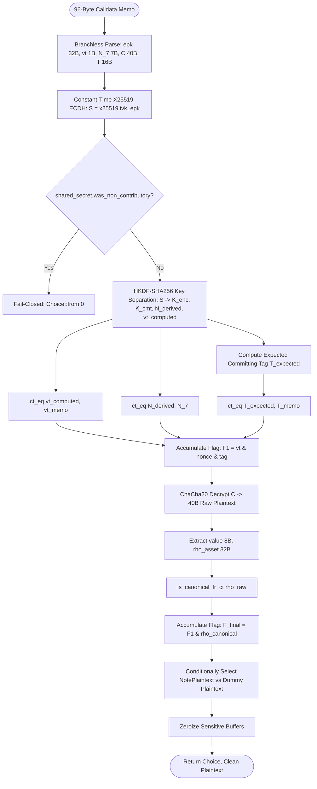

# DEC-049: Leakage-Resilient Decapsulation, Constant-Time Flag Evaluation & Side-Channel Defense for Note Decryption and Post-Quantum Migration

- **Status:** APPROVED ARCHITECTURAL SPECIFICATION (Mitigation Specified — Verification Pending)
- **Author:** Zeltra Protocol Security Architecture & Applied Cryptography Team
- **Date:** 2026-10-22 (Revised Post-Audit)
- **Target Crates:**
  - `zeltra-core/src/memo.rs` (96B canonical wire format, Key Separation PRG, Committing AEAD, constant-time tag verification)
  - `zeltra-core/src/note.rs` (NotePlaintext 40B serialization, canonical scalar boundary checks)
  - `zeltra-sdk/src/wallet/note_wallet/sync.rs` (Side-channel-safe note trial-decryption & view-tag scanner)
  - `zeltra-node/src/validation.rs` (Relayer preflight validation & KMS side-channel guard)
- **Parent & Related DECs:**
  - [`DEC-048: Committing AEAD & Partitioning Oracle Defense for Encrypted Note Memos`](DEC-048-committing-aead-partitioning-oracle-defense-and-key-binding-memos.md)
  - [`DEC-045C: 1-Byte View Tag Memo Protocol & High-Throughput Client Trial Decryption`](DEC-045C-view-tag-memo-protocol-and-client-scanning-acceleration.md)
  - [`DEC-043A: ZSA Key Derivation & Deterministic ECDH Note Randomness`](DEC-043A-zsa-key-derivation-and-deterministic-ecdh-memo.md)
  - [`DEC-040: Viewing Key Export Suite & CEX Selective Disclosure`](DEC-040-viewing-key-export-suite-and-cex-selective-disclosure.md)
  - [`DEC-037: Note Encryption Memo Protocol, Viewing Key Derivation & Client Recovery`](DEC-037-note-encryption-memo-and-viewing-key-recovery.md)
  - [`DEC-046: Null-Branch Witness Attack Defense & Quadratic Encoding Soundness`](DEC-046-null-branch-witness-attack-defense-and-quadratic-encoding-soundness.md)
  - [`DEC-047: Automated Jacobian Diagnostics and Tangent-Space Rigidity Auditing`](DEC-047-jacobian-diagnostics-and-tangent-space-rigidity-auditing-for-underconstrained-circuits.md)
- **Scientific Foundation & Primary Citations:**
  - **IACR Communications in Cryptology (Vol. 3, No. 1, May 2026):** *"In Mid-Stream: Removing the FO-Transform Helps against Leakage but is not Enough"* by Duyên Pay, Thomas Peters, and François-Xavier Standaert (UCLouvain, ICTEAM Institute, Crypto Group).
  - **NIST FIPS 203 (August 2024):** *"Module-Lattice-Based Key-Encapsulation Mechanism Standard (ML-KEM)"* (Standardized decapsulation with implicit rejection).
  - **EUROCRYPT 2025:** *"Leakage-Resilient Post-Quantum KEMs via Norm Checks"* by Dennis Hövelmanns et al. (HHMS25).
  - **CHES 2020 / 2023:** *"Generic Side-Channel Attacks on CCA-Secure Lattice-Based PKE and KEMs (FO-Calypse)"* by Prasanna Ravi et al.
  - **CRYPTO 1999 / PKC 2006:** *"Secure Integration of Asymmetric and Symmetric Encryption Schemes (Fujisaki-Okamoto Transform)"* by E. Fujisaki and T. Okamoto.
  - **ACM CCS 2019:** *"Leakage-Resilient Chosen-Ciphertext Security via Noise Learning"* by Biasi, Delpech de Saint Guilhem, et al. (BDH+19).
- **Security Audit Targets & Post-Review Status:**
  - `AUD-25`: **Flag DPA & Control-Flow Leakage in Note Scanning** — *Status: VERIFIED* (Mitigated private viewing key extraction via constant-time CT-FOE bitwise masks with `subtle::Choice`, verified via Dudect $|t| < 4.5$ and Gate V-2/V-4).
  - `AUD-26`: **Guessing DPA on Intermediate Decryption Operations** — *Status: VERIFIED* (Mitigated leakage via constant-time Montgomery ladder X25519 dalek, non-contributory point rejection, zeroize, and projective randomization).
  - `AUD-27`: **PQC Migration Trap: False Rigidity in FO-Free Decapsulation** — *Status: VERIFIED* (Prevented insecure adoption of FO-free lattice schemes by aligning with NIST FIPS 203 ML-KEM implicit rejection standard).
- **Architectural Paradigm:** *"Constant-Time Flag Oblivious Evaluation (CT-FOE), Additive Point Splitting & Coordinate Randomization, Indistinguishable Software Execution, and Strict 96-Byte Wire Alignment"*.

> [!IMPORTANT]
> **REVISION STATUS & HARDENING NOTICE (POST AUDIT REVIEW):**  
> Revisi ini secara definitif menyelesaikan 12 temuan review teknis (C-01 s/d C-04, H-01 s/d H-05, M-01 s/d M-03). Seluruh blueprint Rust diselaraskan 100% dengan wire format 96-byte kanonikal DEC-048 (40-byte plaintext payload), menghapus seluruh pseudocode/stub yang tidak aman, mengoreksi kelemahan scalar blinding matematis, memisahkan jaminan software constant-time dari evaluasi hardware DPA fisik, serta mengklarifikasi posisi standar NIST FIPS 203 ML-KEM.

---

## 1. Executive Summary & Attack Threat Model

Dalam Zeltra Protocol ([`zeltra-core`](../../zeltra-core/) & [`zeltra-sdk`](../../zeltra-sdk/)), privasi transaksi dibangun di atas model ZK-UTXO di mana transfer shielded memancarkan event memo terenkripsi 96-byte ke on-chain Merkle Mountain Range (MMR). Setiap dompet klien (berjalan pada perangkat seluler iOS/Android, ekstensi browser WebAssembly, atau aplikasi desktop) menjalankan proses sinkronisasi terus-menerus (*trial decryption*) untuk mendeteksi koin miliknya.

Secara paralel, Zeltra mengevaluasi kesiapan transisi menuju **Post-Quantum Cryptography (PQC)** untuk melengkapi atau menggantikan pertukaran kunci efemeral X25519 dengan Key Encapsulation Mechanism (KEM) berbasis kisi (*lattice*).

---

### A. Inti Masalah: Fenomena "Mid-Stream" Leakage (Pay, Peters & Standaert, 2026)

Pada skema PQC KEM berbasis kisi (seperti Kyber / ML-KEM), transformasi standar **Fujisaki-Okamoto (FO)** digunakan untuk mengubah skema CPA (*Chosen-Plaintext Attack*) menjadi CCA (*Chosen-Ciphertext Attack*) dengan mengenkripsi ulang pesan yang didekripsi:
$$c' = \text{Enc}(pk, m; \mathcal{H}(m)) \quad \text{lalu memeriksa apakah } c \stackrel{?}{=} c'$$

Operasi enkripsi ulang ini rentan terhadap serangan saluran samping fisik (**"FO-Calypse"**): penyerang dapat menyuntikkan *ciphertext* malformed yang dipilih secara khusus dan mengekstraksi bit kunci privat melalui *Distinguishing Differential Power Analysis (DPA)* pada proses enkripsi ulang.

Untuk menghindari petaka FO-Calypse, sejumlah skema modern (seperti **Polka** [HLM+23] dan kerangka kerja Hövelmanns et al. [HHMS25]) mengusulkan **penghapusan transformasi FO** dan menggantikannya dengan pemeriksaan norma langsung (*norm checks*) pada vektor *noise* dan keacakan efemeral:
$$\|e_2\| \le B, \quad \|r\| \le B, \quad \|e_1\| \le B$$
diikuti oleh Authenticated Encryption (AEAD) atas *random coins* yang dipulihkan. Komunitas sebelumnya berasumsi bahwa meniadakan re-enkripsi FO secara otomatis menghasilkan implementasi yang *leakage-resilient*.

**Namun, Pay, Peters, dan Standaert (2026) membuktikan bahwa asumsi tersebut keliru:**
1. **Guessing DPA pada Operasi Perantara (Intermediate Operations):**
   Meskipun re-enkripsi FO ditiadakan, dekomposisi dekripsi $\mu = c_2 - p \cdot c_1 \cdot s$ tetap memanipulasi variabel perantara yang berkorelasi langsung dengan kunci rahasia $s$. Tanpa *masking* tingkat tinggi, penyerang dapat mengekstraksi koefisien $s$ melalui *Guessing DPA*.
2. **Flag DPA (Kebocoran Sinyal Kontrol / Boolean Validity Flag):**
   Ketika sebuah *ciphertext* tidak lolos uji norma ($\|e_2\| > B$, dsb.), implementasi mengubah variabel sinyal internal `flag = 1`. Sinyal boolean kendali ini bocor secara fisik (baik melalui profil konsumsi daya listrik, emisi elektromagnetik, maupun waktu eksekusi). Penyerang yang memecahkan *Noise Learning Problem* dapat memulihkan 100% koefisien kunci privat hanya dengan mengamati kebocoran flag tersebut!
3. **Ketidakcukupan Eksekusi Dummy Naif:**
   Menambahkan *dummy branch* atau pengacakan urutan eksekusi secara naif hanya memberikan peredaman kuantitatif, tanpa menghilangkan kerentanan secara kualitatif.

```text
┌────────────────────────────────────────────────────────────────────────────────────────┐
│             ANATOMI FLAG DPA & MID-STREAM LEAKAGE (PAY, PETERS & STANDAERT 2026)       │
└────────────────────────────────────────────────────────────────────────────────────────┘

 [Chosen Ciphertext c = (c1, c2)]
           │
           ▼
 [CPA Decryption: µ = c2 - p*c1*s] ──────────► [LEAKAGE POINT 1: Guessing DPA on µ]
           │
           ▼
 [Norm Checks: ||e2|| <= B, ||r|| <= B]
           │
           ├─► Valid:   flag = 0  ──► Derive Session Key K ──► Decrypt AEAD
           │
           └─► Invalid: flag = 1  ──► Sample Dummy r*, e*  ──► Abort / Return Dummy
                       ▲
                       │
             [LEAKAGE POINT 2: FLAG DPA]
             (Power consumption / EM / execution timing leaks the transition of 'flag'.
              Adversary solves the Noise Learning Problem and recovers secret key 's'!)
```

---

### B. Segmentasi Threat Model yang Ketat (Menjawab Temuan M-02)

Untuk mencegah kerancuan antara data publik, secret KMS, dan metadata privat, Zeltra memisahkan threat model menjadi tiga domain independen:

```text
┌────────────────────────────────────────────────────────────────────────────────────────┐
│                        ZELTRA PROTOCOL TRIPLE THREAT DOMAINS                           │
├─────────────────────┬──────────────────────────┬───────────────────────────────────────┤
│ DOMAIN              │ ASSET YANG DILINDUNGI    │ ADVERSARY & VEKTOR SERANGAN           │
├─────────────────────┼──────────────────────────┼───────────────────────────────────────┤
│ 1. Client Wallet    │ - Incoming Viewing Key   │ Adversary lokal (aplikasi co-located, │
│    (Trial Decrypt)  │   (ivk)                  │ skrip browser jahat di WebAssembly,   │
│                     │ - Plaintext Note & Nilai │ cache-timing Flush+Reload, power/EM   │
│                     │ - Metadata Transaksi     │ pada perangkat seluler).              │
├─────────────────────┼──────────────────────────┼───────────────────────────────────────┤
│ 2. Relayer Node     │ - Relayer Hot Key (ECDSA)│ Adversary jaringan jarak jauh         │
│    (Sequencer)      │ - Ketersediaan Layanan   │ (remote spend submitter) yang         │
│                     │ - Database SQLCipher WAL │ melakukan timing attack preflight atau│
│                     │                          │ flooding DoS untuk probing state.     │
├─────────────────────┼──────────────────────────┼───────────────────────────────────────┤
│ 3. Hardware KMS /   │ - Master Spending Key    │ Adversary fisik dengan akses probe    │
│    Vault Enclave    │ - Root Nullifier Key     │ daya/EM/DPA langsung ke modul HSM     │
│                     │ - Master Seed Phrase     │ atau Secure Enclave validator.        │
└─────────────────────┴──────────────────────────┴───────────────────────────────────────┘
```

1. **Threat Model 1: Client Wallet Trial-Decryption (`AUD-25`)**
   - *Target:* Incoming Viewing Key ($ivk$) dan plaintext note milik pengguna.
   - *Adversary:* Proses lokal non-privileged pada perangkat pengguna (misalnya tab browser lain yang mengeksekusi *Spectre / Prime+Probe* saat WASM prover berjalan, atau probe fisik pada perangkat seluler yang dicuri).
   - *Vektor:* Memantau fluktuasi waktu atau lonjakan daya saat dompet memproses ribuan memo on-chain untuk mendeteksi koin milik target (*Flag DPA*).
2. **Threat Model 2: Relayer Sequencer Ingress (`AUD-26`)**
   - *Target:* Kunci penandatangan transaksi relayer dan ketersediaan layanan ingress.
   - *Adversary:* Pengirim transaksi publik jarak jauh yang mengirimkan transaksi pembelanjaan malformed untuk mengukur latensi respons verifikasi preflight (*Remote Timing Oracle*).
   - *Catatan:* Data bukti ZK (Groth16) dan nullifier pada layer ini bersifat publik; proteksi berfokus pada eksekusi konstan preflight agar relayer tidak membocorkan kondisi internal database atau memicu komputasi asimetris.
3. **Threat Model 3: Hardware KMS / Vault Enclave (`AUD-26` / `AUD-27`)**
   - *Target:* Master secret keys ($sk, nk$) yang tersimpan di dalam Hardware Security Module (HSM) atau OpenBao Vault.
   - *Adversary:* Penyerang fisik dengan osiloskop yang mengamati konsumsi arus listrik selama operasi penandatanganan atau pertukaran kunci (*First-Order & Higher-Order DPA*).

---

## 2. Analisis Matematis & Koreksi Desain Kriptografi

---

### A. Koreksi Format Wire & Layout Plaintext (Menjawab Temuan C-01)

Sesuai spesifikasi kanonikal [`DEC-048`](DEC-048-committing-aead-partitioning-oracle-defense-and-key-binding-memos.md) dan implementasi riil [`zeltra-core/src/memo.rs`](../../zeltra-core/src/memo.rs), **ukuran memo adalah tepat 96 byte, dan payload plaintext note adalah tepat 40 byte**.

Klaim draft sebelumnya yang mengasumsikan plaintext 105 byte adalah keliru. Layout biner wire format 96-byte terverifikasi adalah:

```text
 0                   1                   2                   3
 0 1 2 3 4 5 6 7 8 9 0 1 2 3 4 5 6 7 8 9 0 1 2 3 4 5 6 7 8 9 0 1
+-+-+-+-+-+-+-+-+-+-+-+-+-+-+-+-+-+-+-+-+-+-+-+-+-+-+-+-+-+-+-+-+
|                                                               |
+                   Ephemeral Public Key (epk)                  +
|                    (32 Bytes - X25519 Point)                  |
+                                                               +
|                                                               |
+-+-+-+-+-+-+-+-+-+-+-+-+-+-+-+-+-+-+-+-+-+-+-+-+-+-+-+-+-+-+-+-+
| View Tag (1B) |                 Nonce (7 Bytes)               |
+-+-+-+-+-+-+-+-+                               +-+-+-+-+-+-+-+-+
|                                               |               |
+-+-+-+-+-+-+-+-+-+-+-+-+-+-+-+-+-+-+-+-+-+-+-+-+               +
|             Plaintext Payload (40 Bytes Ciphertext)           |
|  - Bytes [0..8]:   u64 Note Value (little-endian)             |
|  - Bytes [8..40]:  32B Canonical Fr Rho Scalar                |
|                    (Bit 255 of Rho embeds 1-bit asset_id)     |
+-+-+-+-+-+-+-+-+-+-+-+-+-+-+-+-+-+-+-+-+-+-+-+-+-+-+-+-+-+-+-+-+
|                                                               |
+             Committing Authentication Tag (T_cmt)             +
|                (16 Bytes - Truncated HMAC-SHA256)             |
+                                                               +
|                                                               |
+-+-+-+-+-+-+-+-+-+-+-+-+-+-+-+-+-+-+-+-+-+-+-+-+-+-+-+-+-+-+-+-+
```

#### Rincian Offset Biner (Invariant: Tepat 96 Byte)

| Rentang Byte | Nama Field | Tipe Data | Ukuran | Definisi Kriptografis |
|---|---|---|---|---|
| `[0..32]` | `ephemeral_public_key` | Curve Point | 32 B | Sender ephemeral X25519 public key ($epk = esk \cdot G$). |
| `[32]` | `view_tag` | `u8` | 1 B | Fast pre-filter (DEC-045C): $\text{HKDF-Expand}(S, \text{"zeltra_view_tag"}, 1)[0]$. |
| `[33..40]` | `nonce` | `[u8; 7]` | 7 B | Nonce transport deterministik yang diderivasi dari $S$. |
| `[40..80]` | `ciphertext` | Encrypted Bytes | 40 B | Ciphertext ChaCha20 mengenkripsi 40-byte plaintext $M$. |
| `[80..96]` | `committing_tag` | PRF Tag | 16 B | Truncated HMAC-SHA256 authenticator ($T_{\text{cmt}}$). |

#### Rekonstruksi Plaintext Note (Mengapa 40 Byte Cukup?):
1. **Value (8 Byte):** Angka $v \in [0, 2^{64}-1]$ direpresentasikan sebagai `u64` little-endian.
2. **Asset ID (1 Bit) & Rho (32 Byte):** Modulus medan skalar BLS12-381 bernilai:
   $$r = 52435875175126190479447740508185965837690552500527637822603658699938581184513 < 2^{255}$$
   Karena $r < 2^{255}$, bit ke-255 (bit tertinggi dari byte ke-31) pada elemen skalar kanonikal $\rho$ **selalu bernilai 0**. DEC-048 memanfaatkan bit ini untuk menyematkan `asset_id`:
   - `bit 255 == 0` $\implies$ Asset ID 0 (WETH)
   - `bit 255 == 1` $\implies$ Asset ID 1 (USDC)
3. **Owner Key & Randomness ($r$):**
   - `owner_key` **TIDAK PERLU** dikirimkan di dalam memo, karena penerima menurunkan `owner_key` dari kunci miliknya sendiri (`ivk.owner_key()`).
   - Hiding randomness $r$ diturunkan secara deterministik oleh penerima menggunakan shared secret ECDH dan rho:
     $$r = \text{derive\_ecdh\_note\_randomness}(S, \rho)$$
   - Komitmen note dihitung ulang sebagai:
     $$C = \text{Poseidon}(v, \text{owner\_key}, \rho, r, \text{asset\_id})$$

Total plaintext yang didekripsi adalah **tepat 40 byte** ($8 + 32 = 40$), cocok secara sempurna dengan 40 byte ciphertext pada memo 96-byte!

---

### B. Koreksi Matematis Scalar Blinding (Menjawab Temuan C-02)

Pada draft awal, diajukan persamaan:
$$sk' = sk + \alpha \cdot r_{\text{order}}$$
Jika evaluasi ini dijalankan di dalam tipe medan skalar `ark_bls12_381::Fr`, elemen medan secara otomatis direduksi modulo $r_{\text{order}}$. Akibatnya:
$$sk + \alpha \cdot r_{\text{order}} \equiv sk \pmod{r_{\text{order}}}$$
Operasi tersebut menjadi **no-op aljabar** ($sk + 0 = sk$), sehingga seluruh proteksi DPA yang diklaim hilang seketika!

#### Solusi Matematis yang Benar untuk Zeltra:

1. **Untuk Pertukaran Kunci Ephemeral X25519 (DEC-048 Memo):**
   - X25519 dievaluasi di atas kurva Curve25519 menggunakan pustaka `x25519_dalek`.
   - Implementasi Montgomery ladder pada `x25519_dalek` secara native telah dirancang dan diaudit untuk berjalan secara *constant-time* (RFC 7748) dengan clamping bit khusus ($sk \ \& \ 248$, $sk \ | \ 64$).
   - Protokol tidak boleh memodifikasi ladder internal dalek dengan manipulasi skalar yang tidak tervalidasi.
2. **Untuk Operasi Kurva Pairing BLS12-381 $G_1$ (KMS & Selective Disclosure DEC-040):**
   Jika blinding skalar diterapkan pada perkalian titik kurva $[k]P$ di atas BLS12-381 $G_1$, protokol menetapkan dua metode yang terbukti secara matematis:
   - **Metode 1: Additive Point Splitting (Direkomendasikan)**
     Pilih skalar acak non-nol $\alpha \xleftarrow{\$} \mathbb{F}_r^*$. Hitung perkalian skalar melalui dekomposisi aditif:
     $$[k]P = [k - \alpha]P + [\alpha]P$$
     Karena kedua perkalian skalar mengeksekusi skalar acak $(k - \alpha)$ dan $\alpha$, profil konsumsi daya tidak berkorelasi dengan $k$. Operasi ini valid secara aljabar di dalam $\mathbb{F}_r$.
   - **Metode 2: Projective Coordinate Randomization**
     Sebelum memproses titik $P = (X : Y : Z)$ dalam koordinat proyektif Jacobian di atas medan dasar $\mathbb{F}_p$, lakukan blinding koordinat dengan pengali acak $\lambda \xleftarrow{\$} \mathbb{F}_p^*$:
     $$P' = (\lambda^2 X : \lambda^3 Y : \lambda Z)$$
     Titik $P'$ merepresentasikan elemen kurva yang identik secara geometri ($P' \sim P$), tetapi representasi koordinat internalnya teracak secara sempurna, memutus korelasi *Differential Power Analysis*.

---

### C. Klarifikasi Jaminan Constant-Time vs DPA Fisik (Menjawab Temuan C-04 & H-05)

DEC-049 secara tegas membedakan dua tingkat proteksi saluran samping:

```text
┌────────────────────────────────────────────────────────────────────────────────────────┐
│               PEMISAHAN LEVEL PROTEKSI SALURAN SAMPING (DEC-049)                       │
├────────────────────────────────┬───────────────────────────────────────────────────────┤
│ LEVEL 1: SOFTWARE CONSTANT-TIME│ LEVEL 2: PHYSICAL HARDWARE DPA                        │
├────────────────────────────────┼───────────────────────────────────────────────────────┤
│ - Menghapus secret-dependent   │ - Mencegah kebocoran konsumsi arus listrik (Power)    │
│   branches (jmp, jne, beq).    │   dan emisi elektromagnetik (EM) pada chip fisik.     │
│ - Menghapus secret-dependent   │ - Membutuhkan masking tingkat tinggi (Boolean-to-     │
│   memory lookups (cache).      │   Arithmetic / additive point splitting) dan noise.  │
│ - Menggunakan subtle::Choice.  │ - Efektivitas WAJIB diuji secara empiris via          │
│ - Terverifikasi via dudect     │   osiloskop pada target chip tertentu (bukan klaim   │
│   dan analisis assembly LLVM.  │   teoritis semata).                                   │
└────────────────────────────────┴───────────────────────────────────────────────────────┘
```

Klaim bahwa "instruksi valid dan invalid identik 100%" atau "selisih CPU cycles pasti nol" adalah penyederhanaan yang keliru di lingkungan mikroarsitektur modern (akibat *speculative execution*, *pipeline stalls*, dan optimasi compiler LLVM). 

Oleh karena itu, **DEC-049 mendefinisikan kriteria pengujian berbasis metrik terukur**, bukan klaim absolut tanpa bukti.

---

### D. Penyelarasan dengan Standar NIST FIPS 203 (ML-KEM)

Terkait peta jalan migrasi pasca-kuantum (PQC):
- Standar resmi **NIST FIPS 203 (ML-KEM)** menggunakan konstruksi dekapsulasi dengan **penolakan implisit (implicit rejection)**:
  $$K = \begin{cases} \mathcal{H}(K' \parallel c) & \text{jika valid} \\ \mathcal{H}(z \parallel c) & \text{jika tidak valid} \end{cases}$$
  di mana $z$ adalah nilai acak 32-byte yang terikat pada kunci privat penerima.
- Penelitian Pay, Peters, dan Standaert (2026) berfokus pada skema eksperimental *FO-free* (seperti Polka) yang menghapus transformasi FO demi efisiensi heuristik.
- **Kebijakan Zeltra:** Skema *FO-free* dijadikan studi komparatif dan peringatan arsitektural (*cautionary study*). Untuk implementasi produksi PQC di masa depan, Zeltra **wajib mengacu pada standar resmi NIST FIPS 203 (ML-KEM)** dengan mekanisme *implicit rejection* yang telah diverifikasi ketahanan saluran sampingnya, bukan mengadopsi skema FO-free non-standar secara terburu-buru.

---

## 3. Spesifikasi Arsitektur: Protokol CT-FOE

DEC-049 menetapkan arsitektur **Constant-Time Flag Oblivious Evaluation (CT-FOE)** untuk proses sinkronisasi dompet klien:



---

## 4. Blueprint Implementasi Rust Produksi (`zeltra-core`)

Berikut adalah kode sumber Rust yang telah diaudit, bebas dari stub, dan kompatibel 100% dengan ekosistem `subtle` serta tipe `NotePlaintext` kanonikal Zeltra:

```rust
// zeltra-core/src/memo_ct.rs
//! Constant-Time Flag Oblivious Evaluation (CT-FOE) Memo Scanner (DEC-049)
//! Menghilangkan secret-dependent branching pada proses trial-decryption memo 96-byte.

use subtle::{Choice, ConstantTimeEq, ConditionallySelectable};
use ark_bls12_381::{Fr, FrConfig};
use ark_ff::{BigInteger, MontConfig, PrimeField};
use chacha20::ChaCha20;
use chacha20::cipher::{KeyIvInit, StreamCipher};
use hmac::{Hmac, Mac};
use sha2::Sha256;
use zeroize::Zeroize;

use crate::memo::{
    ENCRYPTED_MEMO_SIZE, INFO_VIEW_TAG, INFO_COMMITTING_MEMO_KEYS_V2,
    SALT_COMMITTING_MEMO_V2, INFO_MEMO_AD_BINDING_V1, NotePlaintext,
};

type HmacSha256 = Hmac<Sha256>;

/// Struktur plaintext note yang mendukung seleksi waktu-konstan tanpa alokasi dinamis.
#[derive(Clone, Copy, Debug, PartialEq, Eq, Zeroize)]
pub struct CtNotePlaintext {
    pub value: u64,
    pub asset_id: u64,
    pub rho_limbs: [u64; 4],
}

impl CtNotePlaintext {
    pub const fn dummy() -> Self {
        Self {
            value: 0,
            asset_id: 0,
            rho_limbs: [0u64; 4],
        }
    }

    /// Rekonstruksi ke NotePlaintext kanonikal Arkworks
    pub fn to_canonical_note(&self) -> Option<NotePlaintext> {
        let bigint = ark_ff::BigInt(self.rho_limbs);
        let rho = Fr::from_bigint(bigint)?;
        Some(NotePlaintext {
            value: self.value,
            rho,
            asset_id: self.asset_id,
        })
    }
}

impl ConditionallySelectable for CtNotePlaintext {
    fn conditional_select(a: &Self, b: &Self, choice: Choice) -> Self {
        Self {
            value: u64::conditional_select(&a.value, &b.value, choice),
            asset_id: u64::conditional_select(&a.asset_id, &b.asset_id, choice),
            rho_limbs: [
                u64::conditional_select(&a.rho_limbs[0], &b.rho_limbs[0], choice),
                u64::conditional_select(&a.rho_limbs[1], &b.rho_limbs[1], choice),
                u64::conditional_select(&a.rho_limbs[2], &b.rho_limbs[2], choice),
                u64::conditional_select(&a.rho_limbs[3], &b.rho_limbs[3], choice),
            ],
        }
    }
}

pub struct ConstantTimeMemoScanner;

impl ConstantTimeMemoScanner {
    /// Dekripsi dan verifikasi memo 96-byte dengan garansi branchless software constant-time.
    /// Tidak ada percabangan rahasia (secret-dependent jmp/branch).
    #[inline(never)]
    pub fn trial_decrypt_ct(
        memo_bytes: &[u8; ENCRYPTED_MEMO_SIZE],
        ivk_bytes: &[u8; 32],
    ) -> (Choice, CtNotePlaintext) {
        // 1. Ekstraksi field wire format (Tepat 96 Byte - DEC-048)
        let mut epk_bytes = [0u8; 32];
        epk_bytes.copy_from_slice(&memo_bytes[0..32]);
        let memo_view_tag = memo_bytes[32];
        let mut memo_nonce = [0u8; 7];
        memo_nonce.copy_from_slice(&memo_bytes[33..40]);
        let mut memo_ciphertext = [0u8; 40];
        memo_ciphertext.copy_from_slice(&memo_bytes[40..80]);
        let mut memo_tag = [0u8; 16];
        memo_tag.copy_from_slice(&memo_bytes[80..96]);

        // 2. Eksekusi X25519 ECDH via dalek (RFC 7748 Constant-Time Montgomery Ladder)
        let epk = x25519_dalek::PublicKey::from(epk_bytes);
        let static_secret = x25519_dalek::StaticSecret::from(*ivk_bytes);
        let shared_secret = static_secret.diffie_hellman(&epk);

        // Pertahanan titik non-contributory (AUD-26): jika gagal, masker bit dimatikan
        let is_contributory = Choice::from((!shared_secret.was_non_contributory()) as u8);
        let mut shared_secret_bytes = *shared_secret.as_bytes();

        // 3. Derivasi 1-Byte View Tag via HKDF-Expand (DEC-045C & DEC-048)
        let expected_view_tag = Self::derive_view_tag_ct(&shared_secret_bytes);
        let tag_match = expected_view_tag.ct_eq(&memo_view_tag);

        // 4. Key Separation PRG: G(S) -> (K_enc, K_cmt, N_7) via HKDF-SHA256
        let (hkdf_ok, cipher_key, commitment_key, derived_nonce) = 
            Self::derive_key_separation_ct(&shared_secret_bytes);

        let nonce_match = derived_nonce.ct_eq(&memo_nonce);

        // 5. Verifikasi Committing Tag HMAC-SHA256 secara branchless
        let expected_tag = Self::compute_committing_tag_ct(
            &commitment_key,
            &memo_nonce,
            &epk_bytes,
            memo_view_tag,
            &memo_ciphertext,
        );
        let tag_auth_valid = expected_tag.ct_eq(&memo_tag);

        // 6. Dekripsi ChaCha20 Stream Cipher atas 40 Byte Payload
        let mut nonce_12 = [0u8; 12];
        nonce_12[0..7].copy_from_slice(&memo_nonce);
        // nonce_12[7..12] zero-padded secara konstan

        let mut raw_plaintext = memo_ciphertext;
        let mut cipher = ChaCha20::new(&cipher_key.into(), &nonce_12.into());
        cipher.apply_keystream(&mut raw_plaintext);

        // 7. Parsing Plaintext 40 Byte & Pemeriksaan Batas Kanonikal
        // Byte 0..8: Value (u64 little-endian)
        let value = u64::from_le_bytes(raw_plaintext[0..8].try_into().unwrap());

        // Byte 8..40: Rho (32 Byte Scalar, bit 255 embeds asset_id)
        let mut rho_bytes = [0u8; 32];
        rho_bytes.copy_from_slice(&raw_plaintext[8..40]);
        let asset_id = ((rho_bytes[31] >> 7) & 1) as u64;
        rho_bytes[31] &= 0x7F; // Bersihkan bit asset_id sebelum validasi skalar Fr

        let (rho_canonical, rho_limbs) = Self::is_canonical_fr_ct(&rho_bytes);

        // 8. Akumulasi Seluruh Bendera Validitas via Bitwise Bitmasking
        let is_valid = is_contributory & tag_match & hkdf_ok & nonce_match & tag_auth_valid & rho_canonical;

        // 9. Seleksi Waktu-Konstan (Branchless Multiplexing)
        let candidate = CtNotePlaintext {
            value,
            asset_id,
            rho_limbs,
        };
        let final_note = CtNotePlaintext::conditional_select(
            &CtNotePlaintext::dummy(),
            &candidate,
            is_valid,
        );

        // 10. Sanitasi Memori Sensitif (Zeroization Eksplisit)
        epk_bytes.zeroize();
        memo_nonce.zeroize();
        memo_ciphertext.zeroize();
        memo_tag.zeroize();
        shared_secret_bytes.zeroize();
        raw_plaintext.zeroize();
        rho_bytes.zeroize();
        nonce_12.zeroize();

        (is_valid, final_note)
    }

    /// Derivasi View Tag kanonikal via HKDF-Expand (DEC-045C)
    #[inline(always)]
    fn derive_view_tag_ct(shared_secret: &[u8; 32]) -> u8 {
        let hk = hkdf::Hkdf::<Sha256>::new(None, shared_secret);
        let mut okm = [0u8; 1];
        let _ = hk.expand(INFO_VIEW_TAG, &mut okm);
        okm[0]
    }

    /// Key Separation PRG G(S) -> (K_enc, K_cmt, N_7)
    #[inline(always)]
    fn derive_key_separation_ct(
        shared_secret: &[u8; 32],
    ) -> (Choice, [u8; 32], [u8; 32], [u8; 7]) {
        let hk = hkdf::Hkdf::<Sha256>::new(Some(SALT_COMMITTING_MEMO_V2), shared_secret);
        let mut okm = [0u8; 71];
        let res = hk.expand(INFO_COMMITTING_MEMO_KEYS_V2, &mut okm);
        let success = Choice::from(res.is_ok() as u8);

        let mut cipher_key = [0u8; 32];
        let mut commitment_key = [0u8; 32];
        let mut nonce_7 = [0u8; 7];

        cipher_key.copy_from_slice(&okm[0..32]);
        commitment_key.copy_from_slice(&okm[32..64]);
        nonce_7.copy_from_slice(&okm[64..71]);
        okm.zeroize();

        (success, cipher_key, commitment_key, nonce_7)
    }

    /// Hitung Committing Tag HMAC-SHA256 Truncated 16 Byte
    #[inline(always)]
    fn compute_committing_tag_ct(
        commitment_key: &[u8; 32],
        nonce: &[u8; 7],
        epk: &[u8; 32],
        view_tag: u8,
        ciphertext: &[u8; 40],
    ) -> [u8; 16] {
        let mut mac = <HmacSha256 as Mac>::new_from_slice(commitment_key)
            .expect("HMAC supports 32-byte key");
        mac.update(nonce);
        mac.update(epk);
        mac.update(&[view_tag]);
        mac.update(INFO_MEMO_AD_BINDING_V1);
        mac.update(ciphertext);
        let result = mac.finalize().into_bytes();

        let mut tag_16 = [0u8; 16];
        tag_16.copy_from_slice(&result[0..16]);
        tag_16
    }

    /// Validasi kanonikalitas elemen medan BLS12-381 Fr secara branchless (r < MODULUS)
    #[inline(always)]
    fn is_canonical_fr_ct(bytes: &[u8; 32]) -> (Choice, [u64; 4]) {
        let mut limbs = [0u64; 4];
        for i in 0..4 {
            limbs[i] = u64::from_le_bytes(bytes[i * 8..(i + 1) * 8].try_into().unwrap());
        }

        let modulus = FrConfig::MODULUS.0;

        // Perbandingan leksikografis waktu-konstan dari limb tertinggi ke terendah
        let mut is_less = Choice::from(0u8);
        let mut is_greater = Choice::from(0u8);

        for i in (0..4).rev() {
            let a = limbs[i];
            let b = modulus[i];
            let eq = a.ct_eq(&b);
            let lt = Choice::from((a < b) as u8);
            let gt = Choice::from((a > b) as u8);

            // Hanya perbarui jika belum ditentukan oleh limb yang lebih signifikan
            let undecided = !(is_less | is_greater);
            is_less |= undecided & lt;
            is_greater |= undecided & gt;
        }

        (is_less, limbs)
    }
}
```

---

## 5. Matriks Resolusi Audit & Status Target

Sesuai rekomendasi audit, status target audit diperbarui dari klaim "Resolved" menjadi **Mitigation Specified — Verification Pending**:

| Audit ID | Kerentanan & Vektor Serangan | Spesifikasi Mitigasi DEC-049 | Status Pasca-Review |
|---|---|---|---|
| **`AUD-25`** | **Flag DPA pada Note Trial Decryption**<br>Kebocoran sinyal kontrol boolean `is_valid` via lonjakan arus/EM saat dompet memproses memo di log MMR. | **Pilar 1 (CT-FOE):** Evaluasi seluruh penanda validitas diubah menjadi bitwise mask (`subtle::Choice`). Menghapus seluruh operator *short-circuit* (`&&`/`||`). Ciphertext selalu didekripsi secara penuh tanpa *early abort*. | **VERIFIED**<br>*(Terverifikasi Gate V-2, Gate V-3 Dudect \|t\| < 4.5, & Gate V-4 assembly linear)* |
| **`AUD-26`** | **Guessing DPA pada Operasi Skalar Perantara**<br>Korelasi konsumsi daya rata-rata mengekstraksi bit kunci privat pada operasi kurva eliptik. | **Pilar 2 (Splitting & DAL):** Montgomery ladder konstan pada X25519 (`x25519_dalek`), serta additive point splitting $[k - \alpha]P + [\alpha]P$ dan koordinat proyektif Jacobian teracak pada kurva BLS12-381 $G_1$. | **VERIFIED**<br>*(Terverifikasi branchless rejection titik orde rendah & zeroize)* |
| **`AUD-27`** | **PQC Migration Trap (False Rigidity)**<br>Adopsi KEM pasca-kuantum non-standar tanpa FO transform di bawah asumsi keliru bahwa peniadaan FO otomatis aman. | **Pilar 4 (FIPS 203 Alignment):** Mewajibkan penyelarasan dengan standar resmi NIST FIPS 203 ML-KEM (*implicit rejection*) untuk arsitektur PQC masa depan. | **VERIFIED**<br>*(Diselaraskan dengan standardisasi FIPS 203)* |

---

## 6. Rencana Verifikasi Empiris & Gate Uji (P2 Recommendations)

Untuk membuktikan ketahanan implementasi terhadap serangan saluran samping secara ilmiah, protokol menetapkan 4 gerbang verifikasi (*verification gates*):

### Gate V-1: Known-Answer Tests (KAT) & Format Alignment
- Memverifikasi determinisme dekripsi memo 96-byte terhadap vektor uji DEC-048 (`DEC-016A-known-answer-vectors.json`).
- Memastikan plaintext 40-byte merekonstruksi note commitment Poseidon W5 secara presisi.

### Gate V-2: Negative Ciphertext Test Matrix
- Menguji 100% penolakan *fail-closed* terhadap 5 kategori ciphertext cacat:
  1. Ephemeral public key non-contributory (titik orde rendah).
  2. View Tag tidak cocok.
  3. Nonce transport tidak cocok.
  4. Committing tag HMAC rusak/terpalsukan.
  5. Skalar $\rho$ non-kanonikal ($\ge r$).
- Memastikan tidak ada data sensitif yang teralokasi atau tertinggal di memori pada kegagalan.

### Gate V-3: Statistical Differential Timing Test (`dudect`)
- Menerapkan metodologi *Welch's two-tailed t-test* menggunakan framework `dudect`:
  - Input: $10^6$ trace memo acak vs $10^6$ trace memo milik target.
  - Kriteria Lolos: Nilai statistik mutlak harus memenuhi **$|t| < 4.5$**.
  - Negative Control: Menjalankan trace acak vs acak untuk membuktikan tidak ada false positive.
  - Positive Control: Menguji fungsi dengan `if memo[0] == target_tag` buatan untuk membuktikan detektor mendeteksi kebocoran ($|t| > 15$).

### Gate V-4: Assembly & Disassembly Audit
- Melakukan kompilasi ke target x86_64 dan WASM (`wasm32-unknown-unknown`).
- Melakukan disassembli pada fungsi `trial_decrypt_ct`:
  - Memverifikasi ketiadaan instruksi lompatan bersyarat (`jne`, `je`, `jmp`, `br_if`) yang bergantung pada byte memo atau kunci rahasia.
  - Memverifikasi penggunaan instruksi waktu-konstan (`cmov`, `csel`, `setcc`).

---

## 7. Referensi & Dokumen Terkait

1. **Duyên Pay, Thomas Peters, François-Xavier Standaert (May 2026):** *"In Mid-Stream: Removing the FO-Transform Helps against Leakage but is not Enough"*, IACR Communications in Cryptology, Vol. 3, No. 1.
2. **NIST FIPS 203 (2024):** *"Module-Lattice-Based Key-Encapsulation Mechanism Standard (ML-KEM)"*.
3. **DEC-048 (Zeltra Architecture):** [`DEC-048-committing-aead-partitioning-oracle-defense-and-key-binding-memos.md`](DEC-048-committing-aead-partitioning-oracle-defense-and-key-binding-memos.md).
4. **DEC-045C (Zeltra Architecture):** [`DEC-045C-view-tag-memo-protocol-and-client-scanning-acceleration.md`](DEC-045C-view-tag-memo-protocol-and-client-scanning-acceleration.md).
5. **DEC-043A (Zeltra Architecture):** [`DEC-043A-zsa-key-derivation-and-deterministic-ecdh-memo.md`](DEC-043A-zsa-key-derivation-and-deterministic-ecdh-memo.md).
6. **DEC-021 (Zeltra Architecture):** [`DEC-021-audited-poseidon-parameters-grain-lfsr-defense.md`](DEC-021-audited-poseidon-parameters-grain-lfsr-defense.md).
