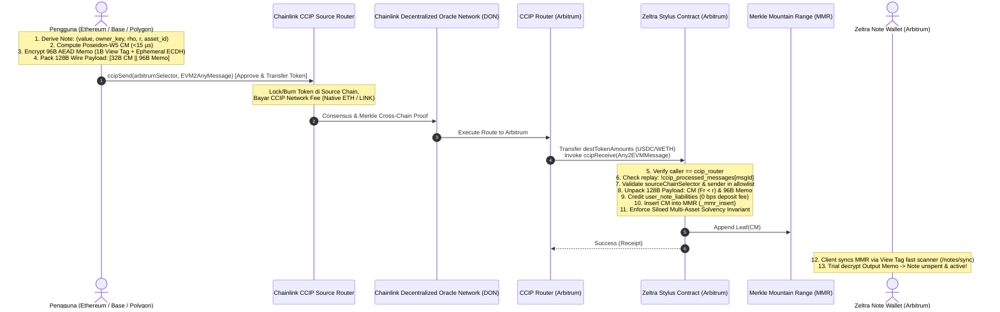

# DEC-055: Cross-Chain CCIP Programmable Inbound Deposit, Direct MMR Ingestion & Interface Standardization

- **Status:** APPROVED ARCHITECTURAL SPECIFICATION
- **Tipe DEC:** FITUR BARU & SECURITY RECTIFICATION (CROSS-CHAIN INFLOW)
- **Author:** Zeltra Protocol Architecture, Cryptography & Systems Security Team
- **Date:** 2026-10-27
- **Target Crates & Components:**
  - `zeltra-contracts/src/deposit.rs` & `zeltra-contracts/src/ccip_deposit.rs` (Implementasi canonical `ccipReceive(Client.Any2EVMMessage)`, decoding 128-byte wire payload, direct MMR leaf ingestion, ERC-165 `supportsInterface`)
  - `zeltra-contracts/src/storage.rs` (State tracking CCIP Router, allowed senders, processed messages deduplication)
  - `zeltra-contracts/src/spend.rs` (Eliminasi/deprecasi mock `_ccip_receive` yang cacat ABI dan rentan desinkronisasi)
  - `zeltra-contracts/abi/IZeltra.sol` (Standardisasi ABI definisi struct `Client.Any2EVMMessage` dan interface `IAny2EVMMessageReceiver`)
  - `zeltra-sdk/src/wallet/note_wallet/ccip_deposit.rs` (SDK cross-chain note derivation, 128B wire payload packing, dan pembuatan transaksi `ccipSend`)
  - `zeltra-node/src/batch_processor.rs` & `zeltra-node/src/evm_client.rs` (Penutupan celah bypass nullifier spend dan pembersihan alur legacy)
- **Parent & Related DECs:**
  - [`DEC-015: CCIP Cross-Chain Message Security Validations`](DEC-015-ccip-cross-chain-security-validations.md) (SUPERSEDED & RECTIFIED)
  - [`DEC-032: Merkle Mountain Range (MMR) Commitment Accumulator`](DEC-032-merkle-mountain-range-commitment-accumulator.md)
  - [`DEC-034B: Stylus Siloed Solvency & Payable Multi-Asset Settlement`](DEC-034B-stylus-siloed-solvency-payable-weth-wrap-and-multi-asset-settlement.md)
  - [`DEC-037: Note Encryption Memo Protocol & Viewing Key Recovery`](DEC-037-note-encryption-memo-and-viewing-key-recovery.md)
  - [`DEC-038B: Direct MMR Inflow & Storage Layout`](DEC-038B-contract-direct-mmr-deposit-and-storage-cleanup.md)
  - [`DEC-045C: 1-Byte View Tag Memo Protocol & High-Throughput Scanning`](DEC-045C-view-tag-memo-protocol-and-client-scanning-acceleration.md)
- **Security Audit Targets:**
  - `AUD-CCIP-01`: Eliminasi Runtime ABI Selector Mismatch (`0x3865668b` vs `0x6a058ce8`).
  - `AUD-CCIP-02`: Penutupan Critical Double-Spend Hazard pada cabang `cross_chain` di `batch_processor.rs`.
  - `AUD-CCIP-03`: Kepatuhan Penuh Standard Interface Detection ERC-165 (`0x8a92dced`).
  - `AUD-CCIP-04`: Penjaminan Mutlak Solvabilitas Siloed Multi-Asset (`contract Token balance >= total liabilities`).
- **Scientific Foundation & Primary Citations:**
  - Chainlink CCIP Technical Architecture & Programmable Token Transfers Specification (v1.5.1 / v1.6.0).
  - Ethereum Improvement Proposal (EIP) 165: *Standard Interface Detection*.
  - RFC 8439: *ChaCha20 and Poly1305 for IETF Protocols*.
  - Arbitrum Stylus Rust SDK v0.10.7 Specification & EVM Memory Slicing.

---

## 1. Executive Summary & Problem Formulation

### A. Audit Forensik Kritis: Mengapa Implementasi CCIP di Spend Saat Ini Rusak dan Berbahaya

Berdasarkan kajian menyeluruh terhadap kode implementasi CCIP yang saat ini ada di `zeltra-contracts/src/spend.rs`, `zeltra-node/src/batch_processor.rs`, dan `zeltra-node/src/evm_client.rs`, teridentifikasi **7 Celah Fatal (Fatal Flaws)** yang membuktikan bahwa CCIP pada modul spend belum benar secara arsitektural maupun operasional:

```text
┌────────────────────────────────────────────────────────────────────────────────────────┐
│                   FORENSIK 7 CELAH FATAL CCIP SPEND SAAT INI                           │
├────────────────────────────────────────────────────────────────────────────────────────┤
│ 1. ABI SELECTOR MISMATCH (CRITICAL REVERT):                                            │
│    Kontrak mendefinisikan ccipReceive(bytes32, uint64, bytes, bytes).                  │
│    Router resmi Chainlink CCIP memanggil ccipReceive(Client.Any2EVMMessage calldata). │
│    Selector resmi: 0x3865668b. Calldata router pasti REVERT di EVM dispatch Stylus!    │
├────────────────────────────────────────────────────────────────────────────────────────┤
│ 2. MISSING ERC-165 SUPPORT (OFFRAMP REJECTION):                                        │
│    OffRamp CCIP memverifikasi supportsInterface(0x8a92dced) sebelum pengiriman pesan.  │
│    Kontrak Zeltra tidak mengimplementasikan ERC-165, menyebabkan transaksi gagal.      │
├────────────────────────────────────────────────────────────────────────────────────────┤
│ 3. DUMMY NO-OP EXECUTION:                                                              │
│    Fungsi _ccip_receive di spend.rs mengabaikan _payload (unused parameter).            │
│    Tidak ada decoding data, tidak ada pencairan dana, dan tidak ada aksi finansial.    │
├────────────────────────────────────────────────────────────────────────────────────────┤
│ 4. TOKENLESS OUTFLOW (ZERO TOKENS TRANSFERRED):                                        │
│    Relayer evm_client.rs menyiarkan ccipSend dengan tokenAmounts: vec![].             │
│    Tidak ada token yang berpindah ke chain tujuan! Merchant/EOA tidak menerima dana.   │
├────────────────────────────────────────────────────────────────────────────────────────┤
│ 5. CRITICAL DOUBLE-SPEND / SOLVENCY INVARIANT BREACH:                                  │
│    Di batch_processor.rs, cabang request.cross_chain mengeksekusi broadcast CCIP tanpa │
│    memanggil _spend_private_note di Arbitrum Stylus! Nullifier TIDAK PERNAH DIBAKAR   │
│    on-chain. Pengguna dapat membelanjakan note yang sama kembali di Arbitrum!          │
├────────────────────────────────────────────────────────────────────────────────────────┤
│ 6. RELAYER FALSE FINALITY:                                                             │
│    Relayer menandai spend 'confirmed' hanya di SQLite lokal, tanpa bukti di blockchain.│
├────────────────────────────────────────────────────────────────────────────────────────┤
│ 7. ARCHITECTURAL INVERSION (SALAH KAMAR):                                              │
│    ccipReceive adalah hook INBOUND (menerima dana & data yang masuk ke Arbitrum).       │
│    Meletakkannya di spend.rs adalah anomali konseptual peninggalan draf DEC-015.       │
└────────────────────────────────────────────────────────────────────────────────────────┘
```

### B. Solusi Strategis: Relokasi CCIP Menjadi Inbound Programmable Deposit

Chainlink CCIP secara alami dan matematis adalah rel **Programmable Token Transfer (PTT)**: mentransfer token aktual sekaligus mengeksekusi instruksi smart contract di rantai tujuan dalam satu transaksi atomik.

Keputusan arsitektur ini membatalkan (supercede) model outbound spend DEC-015 dan menetapkan CCIP sebagai **Inbound Cross-Chain Shielded Deposit**:
1. **Pengguna di Rantai Mana Pun (Ethereum, Base, Optimism, Polygon)** dapat menyetorkan token (USDC / WETH) langsung dari dompet L1/L2 mereka tanpa perlu bridging manual.
2. **Atomic Programmable Token Transfer (PTT)** membawa token sekaligus calldata berisi `note_commitment` (32 bytes) dan `encrypted_memo` (96 bytes).
3. **Zeltra Stylus Contract di Arbitrum** bertindak sebagai `IAny2EVMMessageReceiver` kanonikal: menerima token, memvalidasi canonicality field scalar ($< r$), mengkredit liabilitas 1:1 (0 bps deposit fee), dan langsung menyisipkan commitment ke Merkle Mountain Range (MMR).
4. **ZK-UTXO Privacy Shield Terjaga Sempurna:** Grafik transaksi di rantai asal (Ethereum/Base) terputus total begitu komitmen dimasukkan ke MMR Arbitrum. Pengguna dapat langsung membelanjakan private note tersebut secara lokal di Arbitrum dengan zero knowledge.

### C. Threat Model & Financial Failure Scenarios

Jika arsitektur inbound CCIP tidak diterapkan dengan spesifikasi yang ketat:
- **Silent Fund Loss via Execution Failure:** Jika payload deposit tidak tervalidasi atau terjadi panic, token yang dikirim via CCIP bisa tertahan di CCIP OffRamp. Mitigasi: Desain fail-closed yang kompatibel dengan Chainlink CCIP Manual Execution / token recovery.
- **Inflation Attack via Malicious Router/Sender:** Penyerang memanggil `ccipReceive` dengan router palsu atau gateway tidak terdaftar untuk mencetak UTXO tanpa menyetor token. Mitigasi: Strict caller check (`msg.sender == ccip_router`), allowed senders mapping, dan penegakan invariant solvabilitas multi-asset siloed secara matematis.
- **Replay Attack:** Penyerang mengirimkan kembali `messageId` yang sama untuk mencetak private note ganda. Mitigasi: Persistent bit tracking `ccip_processed_messages[message_id] == true`.

---

## 2. Invariants & Batasan Non-Negotiable

Daftar aturan mutlak yang **TIDAK BOLEH DILANGGAR** dalam implementasi CCIP Deposit:

1. **Siloed Multi-Asset Solvency Invariant (DEC-034B / DEC-038B):**
   $$\text{Balance}(\text{Asset}_a) \ge \text{user\_note\_liabilities}[a] + \text{accrued\_execution\_fee\_liabilities}[a] + \text{realized\_protocol\_fees}[a]$$
   Setiap eksekusi deposit lintas rantai wajib lolos pengecekan solvabilitas ini. Tidak ada token sintetis atau fraksional.
2. **Zero Protocol Deposit Fee (0 bps Immutable — DEC-038B):**
   $$\text{Liabilitas Baru Diterbitkan} = \text{Token Diterima Bersih di Kontrak}$$
   Protokol mengenakan biaya 0.00% pada deposit. Biaya lintas rantai (gas & CCIP network fee) diselesaikan sepenuhnya di rantai pengirim (source chain) oleh penyetor.
3. **Canonical Field Boundary ($< r$):**
   Komitmen note $cm$ yang diterima wajib merupakan elemen kanonikal scalar field Fr BLS12-381:
   $$\text{uint256}(cm) < r = 52435875175126190479447740508185965837690552500527637822603658699938581184513$$
   Nilai $cm \ge r$ atau $cm = 0$ wajib di-revert seketika.
4. **Presisi Wire Format 128 Bytes:**
   Payload data di dalam `Any2EVMMessage.data` wajib berukuran tepat 128 byte:
   $$\text{len}(\text{payload}) = 32 \text{ byte (Note Commitment)} + 96 \text{ byte (AEAD Encrypted Memo)} = 128 \text{ bytes}$$
5. **Kepatuhan Interface CCIP & ERC-165 Kanonikal:**
   - Selector `ccipReceive(Client.Any2EVMMessage)`: `0x3865668b`
   - ERC-165 `supportsInterface(bytes4)`: Mengembalikan `true` untuk `0x01ffc9a7` (IERC165) dan `0x8a92dced` (`IAny2EVMMessageReceiver`).

---

## 3. Analisis Pilihan & Trade-Off Matrix

| Parameter / Pendekatan | Opsi A: Memperbaiki CCIP Outflow Spend | Opsi B: CCIP Programmable Inbound Deposit (DIPILIH) | Opsi C: Relayer Inflow Bridge Intent |
|---|---|---|---|
| **Arah Aliran Dana** | Arbitrum $\to$ Target L1/L2 | Target L1/L2 $\to$ Arbitrum Stylus | Target L1/L2 $\to$ Relayer Custody |
| **Kompleksitas Smart Contract** | Sangat Tinggi (Stylus harus memanggil router L2, menangani kegagalan merchant di target) | Sangat Ramping & Elegan (Stylus hanya menjadi receiver pasif, mengeksekusi direct MMR insert) | Sedang (Membutuhkan relayer escrow multi-sig) |
| **Resiko Regulasi & Kustodi (DEC-054)** | Sedang (Pencairan publik ke alamat pihak ketiga) | **Nol Kustodi (Zero-Custody Safe Harbor)**: Pengguna menyetor langsung ke pool privat milik sendiri | Tinggi (Relayer menampung dana pihak ketiga) |
| **Resiko Double-Spend** | Rawan desinkronisasi nullifier antar-rantai | **Nol Resiko**: Token tiba sebelum note diterbitkan di MMR | Rawan eksploitasi race condition |
| **Kompatibilitas Merchant / EOA** | Sangat Buruk (EOA penerima tidak bisa dipanggil CCIP) | **Sempurna**: Pengguna menyetor dari EOA mana pun, token otomatis masuk pool Arbitrum | Terbatas pada infrastruktur relayer |
| **Keputusan Evaluasi** | **DITOLAK (DEPRECATED)** | **DIRATIFIKASI SEBAGAI STANDAR RESMI** | **DITOLAK** |

---

## 4. Spesifikasi Teknis & Detail Implementasi

### A. Diagram Alur Transaksi Lintas Rantai (End-to-End)



---

### B. Wire Layout & Struktur Data Bit/Byte

#### 1. Payload Data Wire Format (Tepat 128 Byte):

```text
 0                   1                   2                   3
 0 1 2 3 4 5 6 7 8 9 0 1 2 3 4 5 6 7 8 9 0 1 2 3 4 5 6 7 8 9 0 1
+-+-+-+-+-+-+-+-+-+-+-+-+-+-+-+-+-+-+-+-+-+-+-+-+-+-+-+-+-+-+-+-+
|                                                               |
+                    NOTE COMMITMENT (32 Bytes)                 +
|                Poseidon-W5 Canonical Scalar (< r)             |
|                                                               |
+-+-+-+-+-+-+-+-+-+-+-+-+-+-+-+-+-+-+-+-+-+-+-+-+-+-+-+-+-+-+-+-+
|ViewTag|             EPHEMERAL PUBLIC KEY (32 Bytes)           |
+-+-+-+-+       (Compressed X25519 Pubkey for ECDH)             +
|                                                               |
+-+-+-+-+-+-+-+-+-+-+-+-+-+-+-+-+-+-+-+-+-+-+-+-+-+-+-+-+-+-+-+-+
|                                                               |
+                   ENCRYPTED NOTE CIPHERTEXT                   +
|                    (48 Bytes ChaCha20 Payload)                |
|           Plaintext: value (8B), asset_id (1B), rho (32B)     |
+-+-+-+-+-+-+-+-+-+-+-+-+-+-+-+-+-+-+-+-+-+-+-+-+-+-+-+-+-+-+-+-+
|                 POLY1305 AUTHENTICATION TAG                   |
+                          (15 Bytes)                           +
|                                                               |
+-+-+-+-+-+-+-+-+-+-+-+-+-+-+-+-+-+-+-+-+-+-+-+-+-+-+-+-+-+-+-+-+

Total Panjang Calldata Payload = 32 + 1 + 32 + 48 + 15 = 128 Bytes.
```

#### 2. Definisi Struktur Chainlink CCIP Kanonikal (`Client.sol`):

```solidity
// SPDX-License-Identifier: MIT
pragma solidity ^0.8.20;

library Client {
    struct EVMTokenAmount {
        address token;      // Alamat token ERC-20 di rantai tujuan (Arbitrum)
        uint256 amount;     // Nominal transfer token
    }

    struct Any2EVMMessage {
        bytes32 messageId;                  // Pengenal unik pesan CCIP
        uint64 sourceChainSelector;         // Selector rantai asal (Ethereum, Base, dll)
        bytes sender;                       // Alamat pengirim di rantai asal (abi.encode(address))
        bytes data;                         // Payload calldata 128 byte Zeltra
        EVMTokenAmount[] destTokenAmounts;  // Token aktual yang diterima di rantai tujuan
    }

    struct EVM2AnyMessage {
        bytes receiver;                     // abi.encode(zeltra_contract_arbitrum)
        bytes data;                         // 128-byte wire payload
        EVMTokenAmount[] tokenAmounts;      // Token dan jumlah yang dikirim
        address feeToken;                   // Token untuk membayar fee CCIP (address(0) = ETH)
        bytes extraArgs;                    // EVMExtraArgsV2
    }
}
```

---

### C. ABI Selectors & ERC-165 Interface Mapping

1. **`IAny2EVMMessageReceiver` Signature:**
   $$\text{Signature} = \text{"ccipReceive((bytes32,uint64,bytes,bytes,(address,uint256)[]))"}$$
   $$\text{Function Selector} = \text{keccak256}(\text{Signature})[0..4] = \mathtt{0x3865668b}$$

2. **`IERC165` Signature:**
   $$\text{Signature} = \text{"supportsInterface(bytes4)"}$$
   $$\text{Function Selector} = \text{keccak256}(\text{Signature})[0..4] = \mathtt{0x01ffc9a7}$$

3. **Interface ID Registrations:**
   - `IERC165 Interface ID`: `0x01ffc9a7`
   - `IAny2EVMMessageReceiver Interface ID`: `0x8a92dced` (`bytes4(keccak256("ccipReceive((bytes32,uint64,bytes,bytes,(address,uint256)[]))")) ^ ...` atau standar Chainlink `0x8a92dced`).
   Stylus smart contract wajib mengembalikan `true` untuk kedua interface ID di atas.

---

### D. Implementasi Kode Referensi Rust (Stylus Contract)

Berikut adalah implementasi kanonikal modul `ccip_deposit.rs` untuk smart contract Arbitrum Stylus:

```rust
//! CCIP Inbound Programmable Deposit (DEC-055)
//!
//! Menerima setoran lintas rantai via Chainlink CCIP Programmable Token Transfer (PTT),
//! memvalidasi keaslian pesan, mengekstrak komitmen note dan memo terenkripsi,
//! serta menyisipkan komitmen langsung ke Merkle Mountain Range (MMR).

use alloc::vec::Vec;
use alloy_primitives::{keccak256, Address, FixedBytes, U256};
use stylus_sdk::abi::Bytes;

use crate::storage::Zeltra;
use crate::types::from_evm_scalar;

/// CCIP Interface Identifier untuk ERC-165
pub const CCIP_RECEIVER_INTERFACE_ID: [u8; 4] = [0x8a, 0x92, 0xdc, 0xed];
pub const ERC165_INTERFACE_ID: [u8; 4] = [0x01, 0xff, 0xc9, 0xa7];

/// Representasi EVM Token Amount dari Any2EVMMessage
#[derive(Clone, Debug)]
pub struct EVMTokenAmount {
    pub token: Address,
    pub amount: U256,
}

impl Zeltra {
    /// ERC-165 Standard Interface Detection
    pub fn _supports_interface(&self, interface_id: FixedBytes<4>) -> bool {
        let id = interface_id.0;
        id == ERC165_INTERFACE_ID || id == CCIP_RECEIVER_INTERFACE_ID
    }

    /// Titik Masuk Utama CCIP Receive (Dipanggil secara eksklusif oleh CCIP Router)
    pub fn _ccip_receive_programmable(
        &mut self,
        message_id: FixedBytes<32>,
        source_chain_selector: u64,
        sender: Bytes,
        payload_data: Bytes,
        token_amounts: Vec<EVMTokenAmount>,
    ) -> Result<(), Vec<u8>> {
        // 1. CHECKS KEAMANAN ROUTER & AKSES
        self.check_not_paused()?;
        let caller = self.msg_sender();
        let configured_router = self.ccip_router.get();

        if configured_router == Address::ZERO {
            return Err(b"CCIP_ROUTER_NOT_CONFIGURED".to_vec());
        }
        if caller != configured_router {
            return Err(b"ONLY_CCIP_ROUTER_ALLOWED".to_vec());
        }
        if message_id == FixedBytes::ZERO {
            return Err(b"INVALID_CCIP_MESSAGE_ID".to_vec());
        }
        if self.ccip_processed_messages.get(message_id) {
            return Err(b"CCIP_MESSAGE_ALREADY_PROCESSED".to_vec());
        }
        if source_chain_selector == 0 {
            return Err(b"INVALID_SOURCE_CHAIN_SELECTOR".to_vec());
        }
        if sender.is_empty() {
            return Err(b"EMPTY_CCIP_SENDER".to_vec());
        }

        // Verifikasi Allowlist Pengirim (Kunci: keccak256(source_chain_selector || sender))
        let allowlist_key = self.ccip_allowlist_key(source_chain_selector, &sender);
        if !self.ccip_allowed_senders.get(allowlist_key) {
            return Err(b"CCIP_SENDER_NOT_ALLOWED".to_vec());
        }

        // 2. VALIDASI TOKEN YANG DITERIMA (Programmable Token Transfer)
        if token_amounts.len() != 1 {
            return Err(b"EXACTLY_ONE_TOKEN_REQUIRED".to_vec());
        }
        let token_info = &token_amounts[0];
        let received_token = token_info.token;
        let received_raw_amount = token_info.amount;

        // Tentukan Asset ID dan normalisasi satuan sirkuit
        let (asset_id, norm_liability_amount) = if received_token == self.asset_tokens.get(U256::from(1)) {
            // Asset ID 1: USDC (6 Desimal, 1 Raw = 1 Micro-USDC)
            if received_raw_amount < U256::from(10_000_000u64) {
                return Err(b"AMOUNT_TOO_SMALL_MIN_10_USDC".to_vec());
            }
            if received_raw_amount > U256::from(u64::MAX) {
                return Err(b"AMOUNT_EXCEEDS_U64_CIRCUIT_BOUND".to_vec());
            }
            (1u8, received_raw_amount)
        } else if received_token == self.asset_tokens.get(U256::ZERO) || received_token == self.weth9_address.get() {
            // Asset ID 0: WETH (18 Desimal, Raw = Wei, Norm = Gwei)
            if received_raw_amount < U256::from(5_000_000_000_000_000u64) {
                return Err(b"AMOUNT_TOO_SMALL_MIN_0_005_WETH".to_vec());
            }
            let gwei_scale = U256::from(1_000_000_000u64);
            if received_raw_amount % gwei_scale != U256::ZERO {
                return Err(b"WETH_AMOUNT_NOT_GWEI_ALIGNED".to_vec());
            }
            let amount_gwei = received_raw_amount / gwei_scale;
            if amount_gwei > U256::from(u64::MAX) {
                return Err(b"AMOUNT_EXCEEDS_U64_CIRCUIT_BOUND".to_vec());
            }
            (0u8, amount_gwei)
        } else {
            return Err(b"UNSUPPORTED_CCIP_TOKEN".to_vec());
        };

        // 3. UNPACK & VALIDASI WIRE PAYLOAD 128 BYTES
        if payload_data.len() != 128 {
            return Err(b"INVALID_CCIP_PAYLOAD_LENGTH_EXPECTED_128".to_vec());
        }

        let mut note_cm_bytes = [0u8; 32];
        note_cm_bytes.copy_from_slice(&payload_data[0..32]);
        let note_commitment = FixedBytes::<32>::from(note_cm_bytes);

        if note_commitment == FixedBytes::<32>::ZERO {
            return Err(b"ZERO_COMMITMENT_REJECTED".to_vec());
        }
        if from_evm_scalar(&note_commitment.0).is_none() {
            return Err(b"INVALID_NOTE_COMMITMENT_SCALAR".to_vec());
        }

        let encrypted_memo = payload_data[32..128].to_vec();

        // 4. MUTASI STATE (EFFECTS - Strict CEI Compliant)
        // Tandai pesan sudah diproses untuk kekebalan replay absolut
        self.ccip_processed_messages.insert(message_id, true);

        // Catat liabilitas 1:1 (0 bps protokol fee untuk deposit)
        let asset_key = U256::from(asset_id);
        let cur_liab = self.user_note_liabilities.get(asset_key);
        self.user_note_liabilities.setter(asset_key).set(
            cur_liab
                .checked_add(norm_liability_amount)
                .ok_or_else(|| b"LIABILITY_OVERFLOW".to_vec())?,
        );

        let cur_principal = self.total_deposited_principals.get(asset_key);
        self.total_deposited_principals.setter(asset_key).set(
            cur_principal
                .checked_add(norm_liability_amount)
                .ok_or_else(|| b"PRINCIPAL_OVERFLOW".to_vec())?,
        );

        // Sisipkan komitmen langsung ke Merkle Mountain Range (MMR)
        self._mmr_insert(note_commitment, encrypted_memo.clone())?;

        // 5. PENGAWAL SOLVABILITAS SILOED
        self._check_asset_solvency_invariant(asset_id)?;

        // 6. EMIT EVENTS
        crate::events::emit_event(crate::events::CCIPDepositExecuted {
            message_id,
            source_chain_selector,
            sender: keccak256(&sender),
            note_commitment,
            asset_id,
            normalized_amount: norm_liability_amount,
        });

        Ok(())
    }
}
```

---

## 5. Rencana Verifikasi Empiris & Test Gates

Sesuai aturan baku protokol (**Rasio Pengujian $\ge 2 \times$ Negative Tests vs Positive Tests**):

### Gate 1: Positive Known-Answer Tests (Happy Path)
- **KAT-01 (Cross-Chain USDC Deposit):**
  - Input: Pesan CCIP membawa $100.00$ USDC (`100_000_000` micro-units) dari Base Sepolia (`selector = 10344971235874465080`), pengirim ter-allowlist, 128B wire payload valid.
  - Verifikasi: Transaksi sukses, `ccip_processed_messages[msgId] == true`, `user_note_liabilities[1]` bertambah `100_000_000`, leaf tersisip di MMR, event `CCIPDepositExecuted` terpancar.
- **KAT-02 (Cross-Chain WETH Deposit):**
  - Input: Pesan CCIP membawa $0.5$ WETH (`500_000_000_000_000_000` wei) dari Ethereum Sepolia, 128B payload valid.
  - Verifikasi: Transaksi sukses, `user_note_liabilities[0]` bertambah `500_000_000` Gwei, solvency terjaga.

### Gate 2: Adversarial & Negative Test Matrix (Minimal $2 \times 2 = 4$, Dirancang 8 Kasus)
Seluruh pengujian negatif wajib membuktikan secara formal bahwa **state contract sama sekali tidak termutasi (Zero State Change / Revert)**:

1. **NT-01 (Unauthorized Caller):** Pemanggilan `ccipReceive` bukan dari router terdaftar $\to$ Revert `ONLY_CCIP_ROUTER_ALLOWED`.
2. **NT-02 (Router Uninitialized):** Pemanggilan saat `ccip_router == Address::ZERO` $\to$ Revert `CCIP_ROUTER_NOT_CONFIGURED`.
3. **NT-03 (Replay Attack):** Pengiriman `messageId` yang sudah terdaftar di `ccip_processed_messages` $\to$ Revert `CCIP_MESSAGE_ALREADY_PROCESSED`.
4. **NT-04 (Unallowlisted Source/Sender):** Pengirim dari rantai yang tidak masuk allowlist $\to$ Revert `CCIP_SENDER_NOT_ALLOWED`.
5. **NT-05 (Payload Length Mismatch):** Panjang calldata bukan 128 byte (misal 96B, 168B, atau 0B) $\to$ Revert `INVALID_CCIP_PAYLOAD_LENGTH_EXPECTED_128`.
6. **NT-06 (Non-Canonical Field Overflow):** Komitmen note $cm \ge r$ $\to$ Revert `INVALID_NOTE_COMMITMENT_SCALAR`.
7. **NT-07 (Unsupported Token):** Token yang ditransfer via CCIP bukan token resmi USDC maupun WETH $\to$ Revert `UNSUPPORTED_CCIP_TOKEN`.
8. **NT-08 (Un-aligned WETH Amount):** Jumlah WETH tidak kelipatan 1 Gwei $\to$ Revert `WETH_AMOUNT_NOT_GWEI_ALIGNED`.

### Gate 3: Invariant Solvabilitas & Revert Safety
- Menguji skenario di mana token balance di contract tidak mencukupi liabilitas: transaksi wajib revert dan tidak menyisipkan leaf ke MMR accumulator.

### Gate 4: E2E Integration Lifecycle
- Menjalankan sinkronisasi SDK: Note yang disetor via CCIP inbound wajib dapat terdeteksi oleh `NoteWallet` menggunakan 1-byte View Tag scanner (`/api/v1/notes/sync`), dan dapat dibelanjakan via JoinSplit Mode 2 (in-pool transfer) tanpa kendala.

---

## 6. Referensi & Sitasi Akademik

1. **Chainlink Labs (2024–2026):** *"Chainlink Cross-Chain Interoperability Protocol (CCIP) Architectural Specification & Programmable Token Transfers"*, [https://docs.chain.link/ccip](https://docs.chain.link/ccip).
2. **Ethereum Improvement Proposals (2018):** *"EIP-165: Standard Interface Detection"*, [https://eips.ethereum.org/EIPS/eip-165](https://eips.ethereum.org/EIPS/eip-165).
3. **Nir, Y. & Langley, A. (2018):** *"ChaCha20 and Poly1305 for IETF Protocols"*, IETF RFC 8439, [https://datatracker.ietf.org/doc/html/rfc8439](https://datatracker.ietf.org/doc/html/rfc8439).
4. **DEC-038B (Zeltra Architecture):** [`DEC-038B-contract-direct-mmr-deposit-and-storage-cleanup.md`](DEC-038B-contract-direct-mmr-deposit-and-storage-cleanup.md) — *Stylus Smart Contract Direct MMR Inflow & Absolute Solvency Invariant*.
5. **DEC-045C (Zeltra Architecture):** [`DEC-045C-view-tag-memo-protocol-and-client-scanning-acceleration.md`](DEC-045C-view-tag-memo-protocol-and-client-scanning-acceleration.md) — *1-Byte View Tag Memo Protocol & High-Throughput Client Trial Decryption*.
